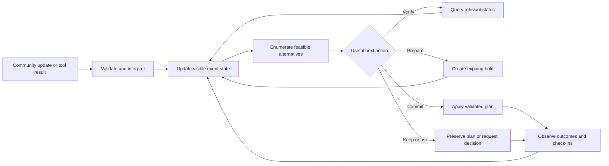

# Architecture and implementation boundary

Status: proposed design, 2026-10-23. This folder specifies a new application. It does not implement that application or establish new empirical results.

## Architectural objective

Build a bounded operations-recovery agent that maintains an explicit goal, reads changing observations, checks useful facts, prepares contingencies, changes an operating plan within delegated authority, and observes the consequences. The primary showcase is a campus event. The second is Pantry Continuity, requiring a quantity-aware domain adapter. A community skills exchange exercises configuration reuse through the campus adapter. Shared components cover observations, roles, grants, transactions, receipts, and the agent loop.

The operating environment must be real within the prototype. A hold occupies a resource in the local state store. A check-in changes availability. A committed plan changes the board participants see. The venue, resources, external messages, and resulting activity outcomes are modeled. The interface identifies this boundary as a sandbox.

An understandable core loop is:



The three featured verbs describe different operational commitments. They are not three mandatory sequential stages. A verified harmless update may require no action. A verified disruption can justify committing immediately. A useful hold can precede a query when both the time window and delegated budget permit it.

## Proposed runtime

| Component | Proposed implementation | Responsibility |
| --- | --- | --- |
| Web interface | Small React and TypeScript application | Goal, schedule, community check-in, updates, action receipts, comparison view |
| Application API | Python with FastAPI and Pydantic | Validate input, authenticate demo roles, expose bounded tools |
| State store | SQLite in a single application process | Transactional event state, holds, receipts, observations, authority grants |
| Agent orchestrator | Explicit bounded loop | Decide which tool to invoke and when to stop |
| Language adapter | Existing model-provider pattern, isolated behind a new interface | Interpret messages into `ChangeSpec`, select permitted operations, explain receipts |
| Candidate evaluator | Deterministic Python module | Generate small alternative set and check constraints and objective costs |
| Scenario runner | Separate privileged harness | Advance simulated time, deliver scheduled observations, evaluate realized outcomes |
| Replay reader | Recorded visible trace | Reliable demonstration fallback and transparent comparison |

These are implementation proposals, not installed dependencies or working services. No training pipeline is required. Select the model and hosting arrangement during implementation using availability, measured latency, structured-output reliability, and cost.

Use a single server process and one sandbox event per demo room initially. The application server owns writes. The browser and model never receive a raw database connection. An in-process timer is sufficient for the first build if expiration is also enforced synchronously during every relevant operation.

## Domain objects

The canonical vocabulary is `EventGoal`, `Activity`, `Resource`, `Observation`, `ChangeSpec`, `CandidatePlan`, `ActionReceipt`, `AuthorityGrant`, `ScenarioDefinition`, and `EventState`. [The data model](07_data_model.md) defines their semantics. [The schemas directory](schemas/) contains machine-readable planning artifacts. Implementation contracts should be generated or validated from one source rather than copied into several independently maintained definitions.

Keep three distinctions throughout the stack:

1. **What someone said:** an immutable `Observation`, carrying source and time.
2. **What it might imply:** a validated `ChangeSpec`, linked to the observation.
3. **What the application has done:** an `ActionReceipt` and updated `EventState`.

A generated explanation is neither new evidence nor an action. A drafted plan is neither a reservation nor an applied schedule.

## Component responsibilities

### Ingestion and interpretation

Inputs include organizer messages, participant check-ins, sandbox supplier responses, and scenario-injected updates. The server assigns trusted provenance, validates event scope, and retains the received payload. The language model proposes entity references, timing, change type, and implications. It can abstain when the affected entity is ambiguous.

The server resolves identifiers against the event registry and validates every evidence reference. Unknown identifiers, impossible time windows, and invented source references produce an explicit repair request or an unresolved interpretation. They never silently create resources or broaden an action grant.

The UI can accept natural-language resource offers. An offer becomes an observation. To enter the planning pool, the resource must have a registered owner, availability window, capacity, relevant capability, and confirmed terms. For the MVP, offers activate a small set of preconfigured resource entries. Arbitrary new resource onboarding is a later extension.

### Visible state projection

`EventState` combines the current goal version, active plan, resources, holds, commitments, observed participant availability, unresolved changes, and remaining action budget. It derives from accepted observations and receipts. Each meaningful update increments a monotonic event revision.

Keep source authority and factual certainty separate. A volunteer controls their own check-in status. That does not establish that a delivery will arrive on time. An organizer can change a priority within their grant. Their estimate of an equipment fault still needs the appropriate status evidence.

### Candidate evaluator

Start with a finite, declared menu of edits. For example, keep the plan, move an independent activity earlier, switch one activity to an approved equipment-free format, substitute a registered backup resource, or use an allowed start-time offset. Compose only a bounded number of edits and report the search boundary.

The evaluator checks a directed acyclic activity graph, activity windows, shared resources, participant availability, capacity, accessibility requirements, and budget. It returns a constraint report for each candidate. The model cannot waive a failed check.

Use explicit time slots and integer currency units. A general-purpose optimizer, arbitrary natural-language planning, citywide matching, and unconstrained resource procurement are outside the MVP.

Separate schedule acceptance from physical readiness. An accepted schedule can assign a delivered item to a future activity under an explicit ETA assumption. That acceptance does not change the resource's status from expected to available. Before an activity starts, the runner checks observed arrival, role availability, and other execution prerequisites. If they do not hold, it records the missed start and invokes recovery. The interface labels the dependent slot as awaiting the resource rather than implying that the event is guaranteed to finish.

### Decision policy

The policy compares keeping the plan, querying, making a provisional hold, and committing one feasible candidate. It uses visible evidence, declared uncertainty scenarios, deadlines, query cost, and reversibility. [The decision policy](05_decision_policy.md) specifies the first implementable heuristic and an optional value-of-information extension.

The policy is not an interpreter of model self-confidence. A phrase such as “I am 90% confident” has no role in feasibility or action authorization.

### Executor and stateful tools

Every mutation validates event scope, authority, idempotency, expected revision, time validity, and resource constraints. A successful mutation writes both the updated state and an action receipt in the same transaction. See [tool contracts](06_tool_contracts.md).

The initial actions affect the prototype board and its modeled resources. Real university bookings, purchases, emails, or messages to community members are separate integrations with separate authorization and reliability requirements. They are not prerequisites for the demonstration.

### Scenario runner and evaluator

The runner owns hidden schedules, latent disruption truth, future observations, random seeds, and outcome labels. Agent-facing code receives only the current visible projection and responses from tools that the agent actually called. The visible planning scenario set contains assumptions, not the held-out realized future.

Use a distinct runner interface and separate serialized structures for private truth and public state. In tests, assert that prompt construction, tool outputs, candidate inputs, and frontend payloads contain no private scenario fields. A filename such as `false_alarm_case` can itself leak the answer, so use opaque episode identifiers in agent-visible inputs.

The evaluator judges completed activities, preserved constraints, unnecessary changes, and cost from state and execution records. A fluent agent explanation does not count as successful task execution.

## Honest reuse from COLLIE

| Repository asset | Transfer to this project | Boundary |
| --- | --- | --- |
| [Typed payload validation](../collie/spec/schema.py) | Pattern for strict model output, evidence references, and server-owned provenance | Create new event-domain types. Keep the inventory `ShockSpec` contract unchanged |
| [Episode runner](../collie/sim/runner.py) | Pattern for one harness, immutable observations, causal order, and hidden-state checks | Event scheduling requires a new runner and state model |
| [Certify-then-hedge controller](../analysis/commitment/cth.py) | Inspiration for graded commitment as evidence changes | Inventory likelihoods, e-processes, and exposure guarantees do not transfer automatically |
| [Model cache](../collie/llm/cache.py) | Content-addressed inference caching pattern | Cache identity must include the new schema, prompt, visible state, and tool definitions |
| [Real-content evaluator](../analysis/real_content_pilot/evaluate.py) | Matched comparisons, operations accounting, and separation of planned from exploratory analyses | Define new task outcomes and freeze the event evaluation before measuring benefits |

The new system can reuse engineering patterns without claiming that the event controller already exists. No original theorem is inherited. “Verification” in this prototype means a scoped operational check and deterministic validation, unless a later result establishes a stronger statistical claim.

## Proposed implementation layout

The following is a future layout, not directories created by this planning task:

```text
apps/plan_b/
  api/                 HTTP adapters and demo role handling
  domain/              Types, constraints, projection, objective
  agent/               Prompting, interpretation, bounded orchestration
  tools/               Query and mutation implementations
  store/               SQLite transactions and migrations
  scenarios/           Public fixtures and separate private runner inputs
  evaluation/          Policies, paired runs, task-state scorer
  web/                 Goal, board, inbox, receipts, participation UI
  tests/               Domain, tool, isolation, and workflow checks
```

Keep imports from experimental COLLIE modules narrow. The demo should have its own dependency boundary so that creating a community event does not initialize inventory benchmarks or research sweep machinery.

## Failure behavior

| Failure | Required behavior |
| --- | --- |
| Model output invalid | One bounded repair attempt, then explicit unresolved interpretation |
| Tool timeout | Record unknown result, preserve state, reconcile by idempotency key before retrying a mutation |
| Stale state revision | Reject mutation, refresh state, recompute affected checks |
| Hold expires | Exclude it from available protection and require reacquisition before commitment |
| No candidate satisfies hard constraints | Return an infeasibility explanation and named organizer choices |
| Conflicting observations | Retain both with provenance, identify the conflict, seek a decision-relevant check |
| Model budget exhausted | Continue deterministic checks and show the unresolved decision |
| Live provider unavailable | Offer clearly labeled recorded replay or deterministic scenario execution |

## Architecture completion criteria

The architecture is implemented when a clean scenario can be loaded, an incoming update changes visible state, an agent calls a relevant tool, the planner returns a checked alternative, a delegated action changes persistent state, and the resulting receipt is visible to another browser. An expired hold, stale revision, duplicate retry, and misleading update must each produce the specified behavior before calling the system reliable.

## Wave 2 domain extension boundary

Implement `domain/adapters/campus.py` and `domain/adapters/pantry.py` behind one explicit adapter interface. Each adapter validates profile-specific state, enumerates permitted candidate edits, checks constraints, returns objective components, and checks realized outcomes. The shared orchestrator consumes those typed results and permitted tool definitions. It does not branch on individual scenario IDs or contain a hard-coded successful pantry sequence.

| Shared service | Campus specialization | Pantry specialization |
| --- | --- | --- |
| Goal and constraint evaluation | Activity completion, fixed venue, timing and equipment compatibility | Original aggregate kit target and deadline, physical stock, staff throughput |
| Resource reservation | Reusable interval occupancy | Global quantity reservation until consumption or release |
| State mutation and idempotency | Schedule and equipment changes | Source-to-destination handoff and irreversible stock consumption |
| Community observations | Facilitator check-in and equipment steward confirmation | Partner stock confirmation and staff-attested physical handoff |
| Outcome projection | Completed required activities | Timestamped target-linked distribution, separately from schedule completion |

The pantry adapter adds `EventGoal.service_targets`, `Resource.consumable_stock`, `Assignment.consumable_allocations`, and explicit stock and target projections. It requires atomic receipt and distribution tools described in [tool contracts](06_tool_contracts.md). Changes to these contracts are implementation work, not evidence of zero-shot transfer. Keep core and adapter changes separately identifiable in the evaluation manifest.

Use the same SQLite transaction boundary for a registered stock transfer: validate the source hold and staff grant, debit the source, release or consume that hold, credit the destination, and write one durable receipt. The destination needs its own reservation before distribution. Do not allow the LLM to fabricate a physical receipt. Staff actions arrive through a separate scoped session in both live sandbox and replay modes.

A partial pantry schedule can respect every resource constraint while missing the original service goal. The interface must display constraint validity and goal achievement separately. A 24-kit partial allocation is not a completed 40-kit target. The first pantry fixture deliberately begins in that state.

## API and data-mode boundary

The optional MBTA adapter lives behind `query_status`. The server owns the credential, allowlisted host, rate limits, relevance filters, and source normalization. The [API plan](16_api_and_access.md) specifies the stored key path, successful read probe, outstanding checks, and live/fixture modes. Live transit context uses wall-clock time. Frozen November examples use the scenario clock. Do not combine them silently.

The three-wave implementation order and gates are canonical in [the roadmap](11_implementation_roadmap.md). Scaling in this build means adding a checked domain adapter and multiple isolated demo events. Multi-tenant production infrastructure, arbitrary inventory systems, and citywide optimization are later work.
