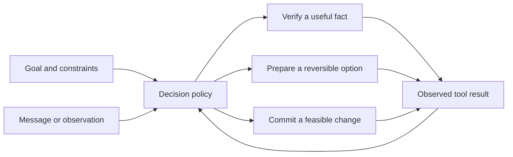

# Seven-minute presentation and demo runbook

Status: proposed script, 2026-10-23. The live system and results described here are deliverables to build. Do not present this script as evidence that they exist.

## One message to remember

**Plan B helps a community event stay on track by deciding what to verify, what to prepare, and when to commit a change.**

The audience should leave able to explain one concrete event recovery, one avoided unnecessary action, and one measured limit. The technical contribution is the decision policy connecting uncertain messages to bounded state changes. The campus event remains the main story. A 45-second [Pantry Continuity cameo](15_pantry_showcase.md) shows the same decision loop with a new quantity-and-fulfillment adapter; its conservation and unmet-service checks make it a distinct second showcase. Neither a relabeled event nor a planned adapter establishes zero-shot transfer.

Keep the public name as a working name until the team checks branding. Introduce COLLIE briefly as the existing research foundation. Most of the seven minutes belong to the new task, behavior, and evidence.

## Seven minutes, exactly 420 seconds

| Clock | Seconds | Presenter action | On-screen evidence |
| --- | --- | --- | --- |
| 0:00–0:35 | 35 | Establish the campus showcase and let the audience choose one disruption card | Goal, deadline, budget, and three large card choices |
| 0:35–1:10 | 35 | Explain the current commitments and what the agent is allowed to change | Small activity timeline and fixed constraints |
| 1:10–2:40 | 90 | Run the chosen disruption through interpretation, verification or preparation, and a real sandbox action | Source-linked change record, one useful check, feasible options, action receipt, updated timeline |
| 2:40–3:35 | 55 | Introduce a stale or duplicate warning and inspect the response | Event/date/booking mismatch, unchanged valid commitments, concise reason |
| 3:35–4:30 | 55 | Explain verify, prepare, commit with one diagram | Inputs, three decision options, planner, tools, resulting observations |
| 4:30–5:40 | 70 | Present the completed primary comparison and one failure or limitation; label an unfinished comparison as pending | One actual results figure or functional readout, sample counts, baseline labels, failure trace |
| 5:40–6:25 | 45 | Show the distinct Pantry Continuity workflow: preserve the 40-kit target, reserve the 16-kit contingency, then show staff receipt and aggregate distribution | 24 on hand, 20 expected but unavailable, alternate 16 held; supply shortfall 16 and service deficit 40; handoff, distribution, and final counters or honest partial/design status |
| 6:25–7:00 | 35 | State delivered behavior, sandbox boundaries, and the next community validation step | Completed evidence only, adapter boundary, and one proposed pilot question |
| **Total** | **420** | **Seven minutes** | **One complete story** |

Rehearse against these boundaries. The presenter should be able to skip an expanded explanation without skipping the evidence of a completed action. Stop the technical explanation at 4:30 even if a question arises. Invite longer discussion after the presentation.

The 45-second pantry segment replaces the old community-profile portability/check-in segment; it is not an eighth minute. Community check-in remains available inside a rehearsed campus branch. The build has exactly the three waves in the [implementation roadmap](11_implementation_roadmap.md): deterministic campus demo; agent, community interaction, and pantry adapter with optional MBTA; evaluation evidence and showcase. Do not claim a later-wave feature solely because it appears in this script.

## Opening script

> “Imagine you are running a campus showcase. People have made time to demonstrate their work, exchange skills, and volunteer. The room is ready, but the projector may be late. Changing the whole program could create more problems. Waiting too long could stop the demonstrations. We built Plan B to decide what to check, what to prepare, and when to act.”

Then present three cards: **Delivery delay**, **Old booking warning**, and **Volunteer running late**. Ask for a show of hands or accept the first clear audience choice. Audience participation does not require a phone, account, or scan.

The starting visual must make the task legible in five seconds. Show the event goal, end time, remaining budget, and a short timeline. Avoid a wall of agent messages. Use large labels for what is confirmed, unresolved, held, and committed.

## The live loop

Use the exact activity/resource values in the [public showcase fixture](examples/campus_showcase.public.json) and its narrative in [community scenarios](02_community_scenarios.md). Its November 5, 2026 date is fictional and unrelated to the hackathon schedule. Do not invent a university reservation or imply that the sandbox controls real campus rooms. The starting event has setup, welcome, demonstrations, skills exchange, and closing. The equipment-dependent activity and the flexible activity make the consequences of a schedule change visible.

The chosen disruption follows this sequence:

1. Inject the selected message into the event inbox. Display its sender label, event/booking identifier, and timestamp.
2. Show the structured interpretation as a concise claim. A claim is not a confirmed fact.
3. Show the agent's next useful action. It may request current delivery status, prepare a reversible backup, or leave the plan alone while waiting for a scheduled observation.
4. Show at most two feasible alternatives, with the relevant time, cost, and affected activities. Reveal an infeasible alternative only if its rejection teaches something immediately understandable.
5. Execute the permitted action inside the prototype. Display its receipt and the changed event state.
6. Introduce the next observation. Show why it causes the hold to be released, retained, or converted into a committed action.

The important proof is the before/after state. If a hold is created, show its identifier and expiry. If the program changes, show the persisted schedule version. If nothing should change, show the current valid version and the checked reason. A paragraph saying “I booked the backup” is insufficient.

Use a visible simulation clock. The presentation can advance fictional event time quickly. Label fast-forwarding so viewers understand that a simulated ten-minute delivery update did not arrive from a real supplier in ten seconds.

## Three cards, one recoverable story

| Audience choice | First segment | Second segment | Within-branch interaction |
| --- | --- | --- | --- |
| Delivery delay | Check current shipment, compare permitted repair, commit or prepare according to the observed status | Old booking warning is rejected as irrelevant | Volunteer checks in or the presenter advances the equivalent fixture |
| Old booking warning | Check identifiers and preserve the current valid plan, then reveal a genuine delivery update within the same segment | Replay the duplicate notice and show idempotent handling | Volunteer checks in or a user changes a permitted priority |
| Volunteer running late | Inspect availability, prepare a limited reassignment, then read a later check-in | Stale equipment warning leaves confirmed arrangements intact | A delivery update prompts a feasible proposal or releases the remaining contingency |

These branches share the same event schema and allowed tools. Prebuild and rehearse each branch. They are not three independent applications. Freeze the scenario bank before collecting the presentation's comparative results.

Finish each branch and any participant check-in before the mechanism segment at 3:35. Its interaction cannot occupy the 5:40–6:25 pantry slot. Optional MBTA context may display an alert and its source time; it cannot establish a volunteer's location, check-in, or arrival time. Show stale information as stale and rely on an actual participant observation for personal availability.

If the team can only make one branch reliable, use the delivery-delay scenario and change the opening to a single collective prediction: “Would you wait, verify, or prepare a backup?” Do not display choices the prototype cannot execute.

## Community interaction

A second device can represent an event-scoped volunteer check-in or an offer of a listed resource. The participant sees only a simple role label and a status button. An offer is an observation that the organizer must validate under the same resource rules. It is not authority to spend money or modify another person's commitment.

Use aliases and synthetic event roles. Collect no personal schedule, location history, or private availability for the stage demo. A presenter-operated button must produce the same logged observation for anyone who cannot or does not wish to use a phone. Read the visible message aloud and do not use color alone to indicate status.

Limit the interaction to one input and one consequence. A live community marketplace is beyond this presentation's scope. The useful question is whether a small, legitimate contribution changes the event plan in a visible and accountable way.

## Pantry Continuity: 45 seconds, 5:40–6:25

Use the fictional staff-controlled workflow in [Pantry Continuity](15_pantry_showcase.md). Describe U-ACCESS only as public service context that motivates the scenario. Do not claim that its staff, systems, inventory, or partners participated. The screen must display **Fictional pantry sandbox**, the original 40-kit service target, and two persistent counters: **supply shortfall** and **service deficit**. All kits are modeled as identical shelf-stable units; any 40-kit capacity or 40-minute service window is a scenario assumption, not a measured throughput claim. The demo has no recipient identity, eligibility, allergen, or medical decisions.

| Clock | Seconds | Action and visible evidence |
| --- | --- | --- |
| 5:40–5:47 | 7 | Show target 40, pantry on-hand 24, expected supply 20, alternate local stock 16, supply shortfall 16, and service deficit 40. |
| 5:47–5:55 | 8 | Reveal the delay and rejected proposal that counts unreceived supply. Expected supply contributes zero usable stock before physical receipt. |
| 5:55–6:04 | 9 | Inspect the successful source-status result for 16 alternate kits and show the agent's allowed reservation. Display the hold receipt. Pantry stock remains 24 while the 16 are held. |
| 6:04–6:13 | 9 | The presenter acts as fictional staff to record the unique handoff: partner stock 16→0 and pantry stock 24→40. Reserve the 40 session kits, refresh validation, and apply the approved plan. Supply shortfall is now 0; service deficit remains 40. |
| 6:13–6:20 | 7 | Visibly advance the sandbox clock to distribution. Staff records aggregate distribution and its receipt, consuming the committed 40 kits. Only this completed service reduces the service deficit to 0. |
| 6:20–6:25 | 5 | Read the original target, kits fulfilled, and both counters. Explain that the shared core required quantity-and-fulfillment rules. If fulfillment is partial, read the actual deficit. |
| **Total** | **45** | **A distinct bounded workflow inside the seven-minute presentation** |

Suggested narration, only after an executed successful rehearsal supports it:

> “The same loop now supports a fictional pantry workflow. Staff need 40 kits; 24 are here and none are distributed. Twenty expected late kits do not count yet. The agent verifies and reserves 16 alternate kits already at this venue. Staff records the handoff, filling the supply gap, then distribution, reducing the service deficit to zero. This required new quantity and service-target rules.”

The agent may inspect evidence, reserve allowed quantities, and propose allocation. Only the staff role can attest physical receipt or aggregate distribution. Show these role boundaries explicitly; a reservation is not a receipt, and a receipt is not a fulfilled service target. A partial handoff of 10 would permit only 34 kits and leave a 6-kit deficit against the original 40. Never reduce the target or count the late expected 20 to create a success badge.

The 45-second trace demonstrates functionality only. It is not a completed transfer evaluation or evidence of a real pantry benefit. If the pantry adapter is unfinished, use the same slot for a clearly labeled **Planned domain extension** slide with the 24 + 16 arithmetic and missing gate. A prerecorded pantry replay is available only after an actual executable run generated its receipts and final state; screenshots or invented successful tool messages cannot supply that evidence.

## Explain the mechanism in 55 seconds

Use a single diagram:

Suggested narration:

> “The model interprets the message. The controller asks whether another check could change the decision. It can prepare an option while uncertainty remains. A planner checks deadlines, resources, and budget before a change is committed. Every action returns a receipt, and the next decision uses what actually happened.”

This is a description of the intended implementation. Revise it to match the final code. If the verification rule is a simple heuristic, name it as such. Do not call it an optimal value-of-information policy unless that claim has been derived and tested.

## Results slide and claim discipline

Use the actual protocol and completed runs from [evaluation](08_evaluation.md). Show P0 rules, P1 capable tool-using LLM, P2 proposed controller, and P3 verify-all when available. Every displayed figure needs its scenario count, trial count, and outcome definition.

The planned primary comparison has eight held-out campus cases and 80 episodes: one P0 run plus three seeds for each of P1–P3 per case. The planned pantry suite is separate: four held-out transfer cases and 40 episodes under the same policy comparison. Display the actual completed counts for each suite and never merge their completion rates. Record equal tools, candidate sets, costs, and grants across policies. Retain rejected candidates and failures; a favorable subset selected after inspecting outcomes cannot support a comparative claim.

Choose one main figure after the metrics are frozen, before looking for a flattering presentation angle. A small paired case plot or table can show completion and unnecessary changes more honestly than a composite leaderboard. Include one trace where the system failed, added unnecessary overhead, or correctly reported an impossible recovery.

If results favor P2, state the tested condition and magnitude. If they are mixed, explain the tradeoff. If the comparison is unfinished, use a clearly labeled functional readout with the number of verified scenarios, and state that comparative performance is pending. Do not replace missing measurements with illustrative bars that resemble measured results.

Safe sentence patterns to fill only with real outcomes:

- “Across [count] fixed scenarios and [count] model trials, [policy] completed [result] under the stated constraints.”
- “The largest difference occurred when [observed condition].”
- “On [case], the extra verification was unnecessary and cost [observed quantity].”
- “The event and pantry workflows reuse [implemented shared components]; pantry support additionally required [implemented quantity and fulfillment components].”
- “The pantry suite completed [actual count] of 40 planned episodes; comparative transfer performance is [actual result or pending].”
- “The next step is a workflow review with community staff; no institutional partnership is claimed.”

Avoid “always safe,” “proven reliable,” “first ever,” “zero-shot transfer,” and claims of real community benefit without partner evidence. Do not transfer the original inventory paper's guarantees to event coordination or the pantry adapter. All results in the current planning pack remain unmeasured.

## Six slides maximum

1. The human problem and a single goal.
2. The live event board, occupying most of the screen.
3. The stale-warning or duplicate-handling moment, usually still in the app.
4. The decision diagram.
5. One comparative result and one failure case.
6. The 45-second pantry board or labeled design slide, followed by delivered scope and the proposed workflow review.

The app can replace slides two and three. Keep implementation details, tool schemas, equations, full source citations, and extended evaluation tables on backup slides or the repository. Faculty and company representatives can inspect those after the initial story.

## Reliability and fallback

Prepare an offline replay using a real recorded successful run. The replay must contain the actual sequence of observations, tool calls, action receipts, and final state from that run. Mark the interface **Recorded replay** throughout. Keep a short screen recording as a second fallback.

Before presenting, choose and display the operating mode: **Live model + sandbox tools** or **Recorded replay**. If the model provider fails during the demo, say “We are switching to a recorded run of the same scenario” and switch visibly. Do not retain a live badge or synthesize successful responses.

Choose the campus and pantry modes independently. A working campus replay does not prove that pantry code exists. For the pantry slot, use a live executable demonstration, its own actual recorded run, or the explicitly labeled design slide. Keep all three versions to 45 seconds. Neither replay nor a design slide is a new measured trial.

Set a rehearsal-based timeout for waiting on a live response. A useful starting target is to switch explanation or replay after ten seconds of unexplained inactivity, but adjust it from actual latency. The timer and fallback policy belong in the runbook, not in a claim of system performance.

Preflight checklist:

- Reset the event and show the initial state version.
- Confirm the three branches that will be offered actually work.
- Confirm the model identifier, network mode, and replay label.
- Verify that a hold, commit, release, and duplicate return matching receipts.
- Verify public fixtures and evaluator fixtures are separated.
- Open the results figure produced by the frozen evaluation.
- Confirm the pantry mode and keep the original target, physical stock, reserved quantity, fulfilled quantity, supply shortfall, and service deficit visible.
- Check the pantry handoff debits its registered source once and cannot be repeated to create extra stock; verify that only staff can attest receipt and distribution.
- Confirm that every verified badge links to the successful tool result that supports it; optional MBTA data has its own freshness label and implies no personal ETA.
- Check display scaling, readable text, keyboard operation, and audio narration.
- Rehearse three uninterrupted runs, including one forced provider failure.
- Keep an explicit final sentence ready at 6:25.

## Closing and likely questions

Suggested closing:

> “Today, Plan B supports [completed campus behavior] in a bounded sandbox. Our comparison shows [actual finding, or comparative evaluation remains pending]. Pantry Continuity is [executed with its quantity adapter, or a planned extension]. The next step is to review these workflows with community staff and test whether the decisions help them preserve their commitments.”

Prepare concise answers to these questions:

| Question | Answer content |
| --- | --- |
| Why does this need AI? | Language interpretation and choosing among tool-supported actions. Show the deterministic baseline so this is an empirical question. |
| What is new? | The implemented and evaluated policy for verification, reversible preparation, and commitment in this bounded workflow. Acknowledge prior work on plan repair and information gathering. |
| What does it actually do? | Point to changed records, versioned plans, holds, releases, and receipts. |
| Can it control university bookings? | The demonstrated tools operate the prototype sandbox. Institutional integration is future work subject to actual access and workflow requirements. |
| What if no solution exists? | The planner returns the blocking constraints and the agent requests a specific user decision without claiming completion. |
| Is this a multi-agent system? | Explain the actual implementation. Multiple model personas are not a requirement for the contribution. |
| Does this work for other communities? | Separate configuration reuse in the community skills exchange from the pantry's quantity-and-fulfillment extension. State exactly which suites ran and their limits. |
| Is this connected to U-ACCESS or real pantry stock? | No integration or partnership is claimed. All quantities, roles, stock, and handoffs shown are fictional sandbox data. |
| Can the agent decide who receives food? | This demo only plans aggregate kit quantities under staff control. It contains no recipient identities or eligibility/allergen decisions. |

See [research sources](12_research_sources.md) for related-work citations and [community validation](10_community_validation.md) for the proposed next step.

## Fallback selection across profiles

If the pantry implementation does not pass its gate, the 45-second slot may instead show an already working skills-exchange profile as **configuration reuse**, with pantry named only as a planned extension. Choose that or the pantry design slide during rehearsal, not both in the same slot. This fallback is not evidence that consumable-stock support works and does not satisfy the full Wave 2 pantry delivery gate. The same choice applies to the community-validation and roadmap fallbacks.
