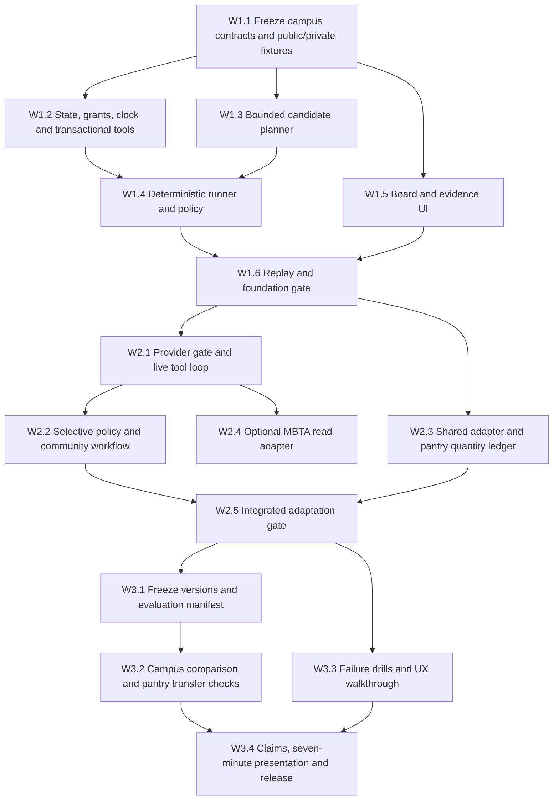

# Implementation roadmap: three waves

Status: proposed build plan, 2026-10-23. This document specifies future implementation. It does not claim that the application, integrations, experiments, or deployment exist or pass their gates.

The implementation has **exactly three waves**. The wave documents below are the execution plans; this document owns their scope, dependency order, and completion rules. Team size and available effort remain unconfirmed. There are no inferred calendar deadlines. Check the actual course/submission requirements before packaging or external submission.

| Wave | Deliverable | Mandatory scope | Detailed execution plan |
| --- | --- | --- | --- |
| 1 — Foundation | A deterministic campus vertical slice | Goal and authority; persistent state; transactional tools; bounded candidate planner; scenario clock; campus board; receipts; replay | [Wave 1: foundation](waves/01_foundation.md) |
| 2 — Adaptation | A live tool-using agent and one shared core across bounded workflows | Model adapter; selective verify/prepare/commit; community participation; community event configuration; fictional staff-directed pantry adapter with quantity accounting | [Wave 2: adaptation](waves/02_adaptation.md) |
| 3 — Evidence and showcase | A measured, reliable, explainable release candidate | Primary campus comparison; separate pantry transfer checks; failure recovery; usability checks; seven-minute presentation; reproducible package and rehearsal | [Wave 3: evidence and showcase](waves/03_evidence_showcase.md) |

An optional MBTA read adapter belongs to Wave 2. A polished second pantry demonstration belongs to Waves 2 and 3, after its quantity contract works. Neither creates another wave or replaces the campus demonstration and evaluation. Pantry is the selected second domain; coffee/Dunkin remains a future illustration and adds no tasks, APIs, or evaluation cases to these three waves.

## Product boundary and completion standard

The primary application helps an organizer recover a fixed-venue campus event with four to six activities, scarce resources, volunteer availability, and an authorized budget. A user submits an update, sees the agent interpret it, observes a relevant tool call, reviews a feasible change or justified decision to wait, and verifies the result through a receipt and a fresh state read. The event continues from that state without resetting to a predetermined outcome.

The pantry extension uses the same orchestration, provenance, grants, revision checks, receipts, and replay. Its domain adapter adds consumable quantities and staff-directed distribution. The fictional target is **40 shelf-stable kits**, with **24 on hand**, **20 expected late**, and **16 confirmed under a partner steward at the same venue**. Expected supply becomes usable only after an authorized receipt records arrival. Partner stock becomes pantry stock through a staff-confirmed handoff that debits one location and credits the other atomically. The extension needs quantity reserve, release, receive, distribute/consume, and conservation checks; changing labels on campus equipment does not implement it. It does not decide recipient eligibility, connect to PantrySoft, or contact a real pantry.

All mutations are local sandbox operations. Live campus bookings, external reservations, purchases, emails, and community messages are outside the build. A participant interaction changes the local board and its evidence record. An MBTA response may supply advisory transit evidence; it cannot authorize a booking or prove a volunteer's arrival.

Wave 1 can ship as a labeled deterministic prototype. Wave 2 can be demonstrated live only after the LLM gate passes. The complete three-wave deliverable requires every mandatory exit criterion below; a reduced delivery must name the unfinished criteria and use claims supported by its actual evidence.

## Dependencies and milestones

The MBTA branch is optional and has no edge blocking the adaptation gate. UI layout, public fixture review, and API access checks can run in parallel with foundation implementation; dependent live mutations wait for the state/tool contracts. Wave 3's harness and reporting code can start earlier, but held-out measurements wait for the frozen build.

| Milestone | Concrete evidence required to pass | Failure response |
| --- | --- | --- |
| M1 — Foundation complete | A clean local run loads the campus fixture, handles genuine/stale/impossible development cases, enforces authority and invariants, and replays the same visible receipts and final state | Fix the state/tool boundary; remove optional UI polish; do not build live actions over unreliable writes |
| M2 — Adaptation complete | A live model interprets an update and uses bounded tools; a community check-in affects planning; the shared core runs a pantry trace with conserved quantities and no expected-stock consumption | Isolate the failed adapter or provider; keep the working campus slice demonstrable; mark the unmet live or pantry criterion explicitly |
| M3 — Evidence and showcase complete | A frozen, honestly counted campus comparison; separate pantry results; no executed invariant violations in release checks; three consecutive selected-scenario rehearsals; seven-minute presentation and offline fallback | Fix and rerun affected evidence or reduce the reported scope; label a partial evaluation and exclude unsupported claims |

Passing an earlier milestone does not establish a later one. A successful recording supports a demonstration claim; it does not establish that the provider is currently reachable or that comparative improvement was measured.

## Work ownership and proposed files

These roles describe responsibilities, not an assumption that four people are available. Assign one accountable owner to each task before coding. For one implementer, execute the dependencies sequentially; for two, combine environment with agent work and product with evidence work.

| Role | Owns | Required reviewer |
| --- | --- | --- |
| E — Environment and contracts | `domain/`, `store/`, `tools/`, scenario clock, domain adapters, invariants | V reviews isolation/scoring; A reviews tool ergonomics |
| A — Agent and integrations | `agent/`, provider setup, bounded orchestration, optional `integrations/mbta.py` | E reviews every mutating path and adapter boundary |
| U — Product and participation | `web/`, participation endpoints and role views with E, explanation and replay UI | A verifies that displayed actions match receipts |
| V — Verification and release | `evaluation/`, consequential tests with E, run manifests, reports, presentation and release checklist | E reviews scoring; U reviews explanation and usability |

Runtime paths in the wave documents are proposed paths under `apps/plan_b/`; they are not a claim that those files currently exist. Use [architecture](04_architecture.md), [tools](06_tool_contracts.md), [data model](07_data_model.md), and [planning schemas](schemas/README.md) as the contract references. Preserve the existing COLLIE inventory experiments and their types. Reuse compatible tooling and engineering patterns without relabeling inventory results as event or pantry evidence.

The shared core owns observations, provenance, authority, clock, revisions, idempotency, receipts, policy orchestration, and replay. Domain adapters own resource semantics, allowed candidate edits, readiness checks, and goal scoring. No separate pantry agent, transaction store, or competing receipt format should be introduced. Freeze shared interfaces before parallel coding; update fixtures, consumers, and focused checks together when they change.

## API and access gates

Use [API and access requirements](16_api_and_access.md) for the access record and implementation setup.

| Gate | Status and requirement | Owner and acceptance evidence | Effect if unavailable |
| --- | --- | --- | --- |
| G-LOCAL | Local application API and sandbox status tools are to be implemented in Wave 1; no external credentials required | E: clean startup, validated requests, receipts and following reads agree | Blocks M1 if state/tool semantics fail |
| G-LLM | An existing nonsecret model registry is available, but current provider access has not been validated. A usable endpoint, model identifier, and credential are required for live Wave 2 | A: during implementation, check the existing setup first; one structured interpretation and bounded tool call through the selected adapter, recording model/version, latency, errors and spend cap without secrets | Deterministic work continues; live-agent claims and the full stochastic evaluation remain incomplete; request endpoint/model/key only if existing access is unusable |
| G-MBTA | User supplied a credential; a read-only `GET /routes/Red` probe returned HTTP 200. The optional adapter and its behavior still need implementation checks | A: scoped live reads plus fixture/replay validation; record no-data, authorization, rate-limit and error behavior without exposing the credential | Disable the adapter and use labeled fixture transit evidence; blocks no mandatory milestone |
| G-SUBMISSION | Confirm the actual requirements, destination, cutoff, and permitted artifact format | V: record requirements and reconcile the release checklist | Prepare a local reviewable package; external publication/submission requires its own authorization |

No other external API is mandatory. Campus resources, volunteer check-ins, alternate pantry stock, receipts, and distribution are modeled through local tools. PantrySoft, institutional scheduling, maps, messaging, identity providers, and payment APIs are not dependencies. Hosting is optional; the release candidate must run locally and support offline replay.

Credentials stay in the environment or an ignored local secret store. Logs and manifests record configuration names and provider identity, never values. A provider smoke check must exercise the intended structured-output/tool path; a successful HTTP connection alone is insufficient. This roadmap does not claim a paid model call or model access test has occurred during planning.

## Required scope, stretch scope, and cut order

| Area | Mandatory for the full three-wave plan | Stretch after the relevant gate passes |
| --- | --- | --- |
| Campus | One complete deterministic and live loop, checked candidates, real sandbox mutations, authority, stale/impossible cases, community check-in, receipts and replay | Richer organizer controls, additional activity templates, animation |
| Configuration | `community_skills_exchange` loads through the event adapter and supports one demonstrated changed constraint | Additional community profiles |
| Pantry | One bounded adapter, 40/24/20/16 fixture, quantity operations and conservation, functional trace plus separate transfer checks | A polished second live demo and broader consumable scenarios |
| Integrations | One validated model provider for live operation | MBTA read adapter; a hosted copy of the local application |
| Evidence | The fixed campus protocol, actual completed counts, common executor/planner, P0–P3 comparison, functional checks, failure trace, separate pantry reporting | Extra trials, broader transfer suite, diagnostic extraction corrections |
| Presentation | Seven-minute campus narrative, actual measured result or explicit absence of comparison, three rehearsals, replay and package | Short pantry insert only if it improves the timed story |

Cut optional visual polish, extra profiles beyond those specified, the MBTA adapter, and a second live pantry presentation before weakening authority checks, quantity accounting, meaningful baselines, or evidence integrity. If mandatory scope remains incomplete, deliver the strongest verified subset and list the gap. Do not call a deterministic policy a live LLM agent, a phantom reservation a tool action, or an unrun protocol a result.

No open-ended procurement, public recruitment, citywide routing, multiple venues, eligibility decisions, native mobile app, multi-agent roleplay, probabilistic confidence display, or new theorem is required. Optional probabilistic value-of-information work follows the deterministic policy; it does not block any wave.

## Evaluation and effort accounting

The primary campus evaluation remains **80 episodes**: eight held-out cases, P0 once per case, P1/P2/P3 three fresh model trials per case: `8 × (1 + 3 + 3 + 3)`. The two planned campus development cases, the skills-exchange configuration fixture, the pantry development case, and the pantry transfer suite are separate. Only one campus development trajectory is supplied in this planning package; author the second in Wave 1. Freeze the cases, prompts, model, costs, tool semantics, planner and caps before collecting the comparison. Use [evaluation](08_evaluation.md) for scoring and reporting rules.

The separate pantry comparison plans **40 additional episodes** across four held-out cases using the same repetition pattern. The complete workload is 120 episodes with two distinct denominators. A one-trial-per-policy pantry subset is 16 episodes and must be labeled partial. Prioritize a working campus comparison before spending the budget on pantry trials; functional pantry traces alone support a capability demonstration, not comparative transfer results.

If only one trial per policy on all eight cases completes, report **32 completed campus episodes**, with missing repetitions explicitly stated. This is a labeled partial result, not a replacement primary protocol. Record other partial counts just as precisely. Never pool pantry runs into the campus denominator, count cached responses as fresh trials, or mix policy versions in a headline figure. Keep failed and timed-out episodes in the reported record.

The former 24-hour and 48-hour windows are **optional illustrative effort budgets**, not delivery dates or alternative implementation phases. A roughly 24-person-hour allocation may prioritize M1, one live campus path, and the smallest honest evidence package; it cannot promise all three milestones or 80 episodes. A roughly 48-person-hour allocation may fund additional integration, pantry checks, repeated trials, and rehearsal, subject to measured runtime and staffing. Estimate task effort after M1 from actual throughput. The three waves and their exit criteria remain the source of truth regardless of available hours.

## Release evidence and handoff

Each wave ends with a short record of completed task IDs, changed files, checks run and not run, known limitations, API gate status, and unresolved dependencies. Record design changes in [risks and open decisions](14_risks_and_open_decisions.md). Keep raw traces and frozen manifests sufficient to recreate the claimed behavior without exposing evaluator-only state to the agent or browser.

The final local package includes setup instructions, example configuration names, fixtures with public/private separation, supported-scope and sandbox labels, a runnable demo, sanitized replay, the frozen evaluation manifest, completed results and failure trace, the seven-minute script, citations/license notes, and a submission checklist checked against actual requirements. Publish or submit only when authorized. No external contact is required to finish the implementation; an interview guide and a local workflow walkthrough can be prepared without inventing community validation.
