# Demo runbook: the seven-minute Plan B demo (Wave 2)

This is the runbook and the story for the live seven-minute demo. It fits the 420-second plan in
[`09_seven_minute_presentation.md`](../../09_seven_minute_presentation.md). It uses only behavior
that Wave 2 delivers and evidence that was actually recorded. Every frame below comes from
[`apps/plan_b/tests/e2e/storyboard.py`](../../../apps/plan_b/tests/e2e/storyboard.py), which
clicks through this exact story against a real local server, from a clean start, with no model
call. Its checks are in [`evidence/storyboard/storyboard_report.json`](evidence/storyboard/storyboard_report.json).

Everything shown is a **fictional, local sandbox**. The live-agent results are **development
runs, each a single trial**. **No comparison between policies has been made.**

## 1. The message and the story

**One sentence:** *Plan B helps a community event stay on track by deciding what to verify, what
to prepare, and when to commit a change.*

The audience should leave able to retell three things:

1. one concrete recovery: the projector is late, so the plan is verified, then changed, with a receipt;
2. one avoided unnecessary action: a stale warning changes nothing;
3. one honest limit: no comparison has been run yet. A development run also caught a bug in our
   own P1 (tool-use) harness; the bug was fixed, and the failed run is kept on record.

The story arc:

1. **The campus showcase.** It has a goal, a deadline, a budget and five activities.
2. **The delayed projector.** The notice is only a claim. The coordinator **verifies** it with
   one status query, then **commits** a free swap that the planner checked.
3. **A stale warning and its duplicate.** Both are handled without churn: no hold, no spend, no
   plan change.
4. **The paid backup.** The coordinator **prepares** a free, expiring hold and asks for the money.
   The organizer approves in their own session, and only then is the backup committed.
5. **The live LLM coordinator's decision card (P2).** This is a recorded replay of a paid run. It
   shows the model call that chose the action, the cost, and the receipt the server checked. P1
   (tool-use) and P3 (verify-all) are the comparison policies; no comparison has been run. This
   segment also shows one failed development run, kept on record: it caught a bug in our P1
   harness, which was fixed.
6. **A participant's own check-in.** It changes the plan. As an option, a resource offer is
   checked and activates a backup kit without spending anything.
7. **The Pantry Continuity cameo (45 s).** The target is 40 kits. The supply shortfall and the
   service deficit are separate counters. Staff confirm the handoff and the distribution.

### Decisions recorded for this runbook (made by the automated build; no human has reviewed them yet)

- **Order.** The segments follow the arc above. 09's own table puts the participant check-in
  before 3:35 and a 70-second results slot at 4:30–5:40. There is no comparative result to fill
  that slot. So the functional readout and the failure trace sit inside the live-agent segment
  (4:00–4:55), and the check-in takes 4:55–5:40. The pantry slot (5:40–6:25) and the close
  (6:25–7:00) keep 09's times.
- **Opening.** Use one collective prediction, "Would you wait, verify, or prepare a backup?",
  rather than 09's three cards. The arc is fixed, and 09 says not to show choices the demo will
  not execute.
- **Operating mode.** The **default** is the deterministic coordinator, acting live in the
  browser, for the campus, community and pantry segments, plus a **Recorded replay** for the live
  LLM segment (section 2).
- **Which recorded runs.** The live card is `live_p2-live_dev02` (P2 with the finishing step's
  code, 2026-10-25). The failure on record is `live_p1-tool-use_pantry_dev01`, P1's first live
  pantry run. It failed on a **defect in our P1 harness**, not on the model's judgment and not on
  the tool-use approach. Prompt `tool_use.v1` never said which window a hold covers, and the
  1536-token turn limit counted the model's reasoning tokens. The fix was prompt `tool_use.v2`
  and a 4096-token limit. The rerun `live_p1-tool-use_pantry_dev01_r2` distributed 40 of 40, and
  the failed run is kept and marked superseded (`apps/plan_b/plan_b/evaluation/development/README.md`).
  This framing is checked against that README and the two runs' records.

## 2. Operating mode: choose and say it before you start

| Segment | Default mode (rehearsed by the storyboard) | Label on screen |
| --- | --- | --- |
| Campus, community, pantry | **Deterministic policy** acting on the sandbox. Every action is real inside the sandbox and returns a receipt | Header badge "Deterministic policy" |
| Live LLM coordinator | **Recorded replay** of an actual paid run (`live_p2-live_dev02_trace.json`) | Purple "Recorded replay" banner on every replay page; "Integrity check passed" |

**Optional live mode** ("Live model + sandbox tools") is possible but **unrehearsed**. The only
browser run of the live agent is one audit check: on a fresh `dev01`, one press of **Run live
agent** made 3 model calls in 11.5 s for $0.03655 (verify, then the swap, then keep). That
confirms the button works; it is not a rehearsal. Use it only after a human rehearsal on the
stage machine, with the endpoint configured (`.local/keys/model_endpoint.env`
and the key file, read only by the server). The spend caps
(`PLAN_B_MODEL_MAX_RUN_COST_USD`, `PLAN_B_MODEL_MAX_TOTAL_COST_USD`) and the ledger
`apps/plan_b/var/model_spend.json` stay in force.

To run it, select **Live agent · anthropic/claude-sonnet-5.5** before the first run of a newly
loaded `dev01`, then click **Run live agent**. The recorded runs give the budget: `live_dev01`
and `live_p2-live_dev01` made 3 model calls each, with 10.8 s and 10.6 s of model latency, for
$0.0360 and $0.0366.

## 3. Setup from a clean state

Run these from the repository root, on the stage machine, before the projector is on.

```bash
cd apps/plan_b
unset VIRTUAL_ENV
uv sync --all-groups --locked
(cd web && npm ci && npm run build)
uv run python scripts/demo_prep.py          # var/demo: an empty state dir + verified recorded traces
PLAN_B_MODERATOR_CODE='<choose one; never project it>' \
  uv run plan-b serve --port 8790 --var var/demo/state --replay-dir var/demo/replays
```

`demo_prep.py` reads no key and no endpoint settings. It prints the serve command and the URLs.
It refuses to replace any directory that it did not create itself. With `--serve` it becomes
that same server, as one foreground process: Ctrl+C or its PID stops it.

Browser: Chromium or Chrome, 1920×1080, **zoom 125 %**. That makes a 1536×864 page, the size of
every frame below. Prepare four tabs:

| Tab | URL | Notes |
| --- | --- | --- |
| T1 Moderator board | `http://127.0.0.1:8790/` | Sign in with the moderator code **before** projecting |
| T2 Live card replay | `http://127.0.0.1:8790/#/replay/live_p2-live_dev02_trace.json` | Click **Final recorded state** once, and scroll to *Policy decisions* → the **Commit** card |
| T3 Failure on record | `http://127.0.0.1:8790/#/replay/live_p1-tool-use_pantry_dev01_trace.json` | **Final recorded state**, then scroll to *Policy decisions*. Its fixed rerun is `#/replay/live_p1-tool-use_pantry_dev01_r2_trace.json` (40 of 40) |
| T4 Pantry fallback | `http://127.0.0.1:8790/#/replay/pantry_dev01_trace.json` | Only if the live board fails (section 6) |

The role tabs (organizer, peer lead, kit steward, pantry staff) are opened **during** the demo:
**Role sessions → Issue join code → Open in new tab**. Join codes are one-time and belong to
one episode. **Loading a new case signs every role tab out**, so a role tab can never be
pre-opened for a later case. A join link shows a code prefix, so keep it off the projector (a
second screen or device works too).

## 4. Run of show (420 seconds)

The **Clicks** column gives the exact button labels. **Point at** is what to show. **Say** gives
short speaker lines. Times are the scenario clock, shown in the header, in America/New_York. The
scenario clock is simulated, so say "fast-forward" whenever you advance it.

### 0:00–0:35 · The campus showcase (35 s)

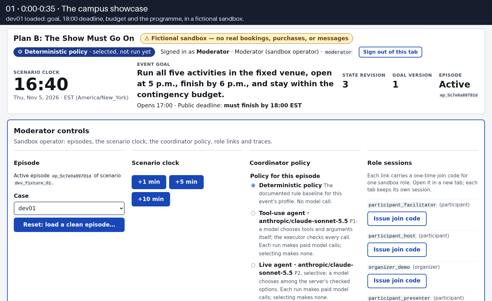

- **Clicks (T1):** Case `dev01` → **Load episode** (or **Reset: load a clean episode…** →
  **Close it and load case dev01**).
- **Point at:** "Fictional sandbox — no real bookings, purchases, or messages"; the badge
  "Deterministic policy · selected, not run yet"; the scenario clock 16:40; "must finish by
  18:00"; state revision 3.
- **Say:** "A campus showcase opens at five. People are ready to demonstrate their work, but the
  projector may be late. Rebuilding the whole program creates problems; waiting too long stops the
  demos. Would you wait, verify, or prepare a backup?"

### 0:35–1:10 · What is committed, and what the agent may change (35 s)

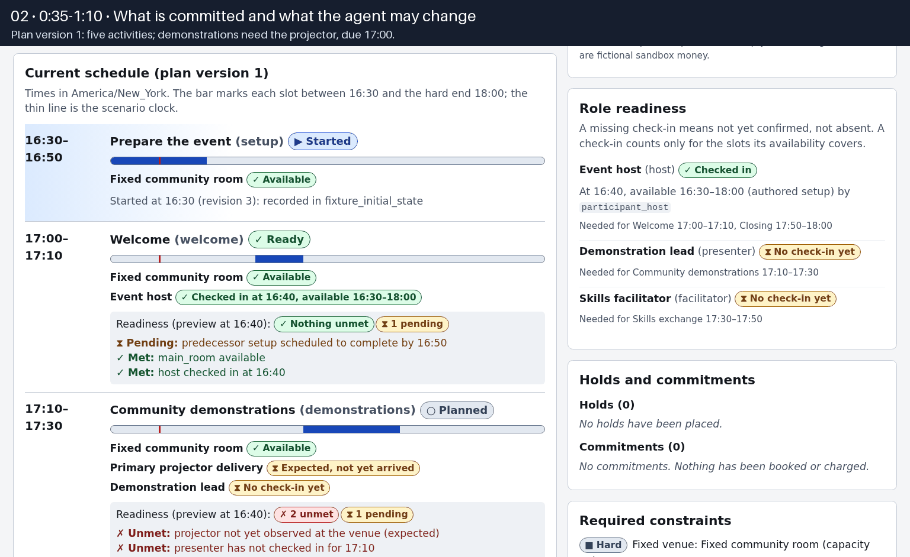
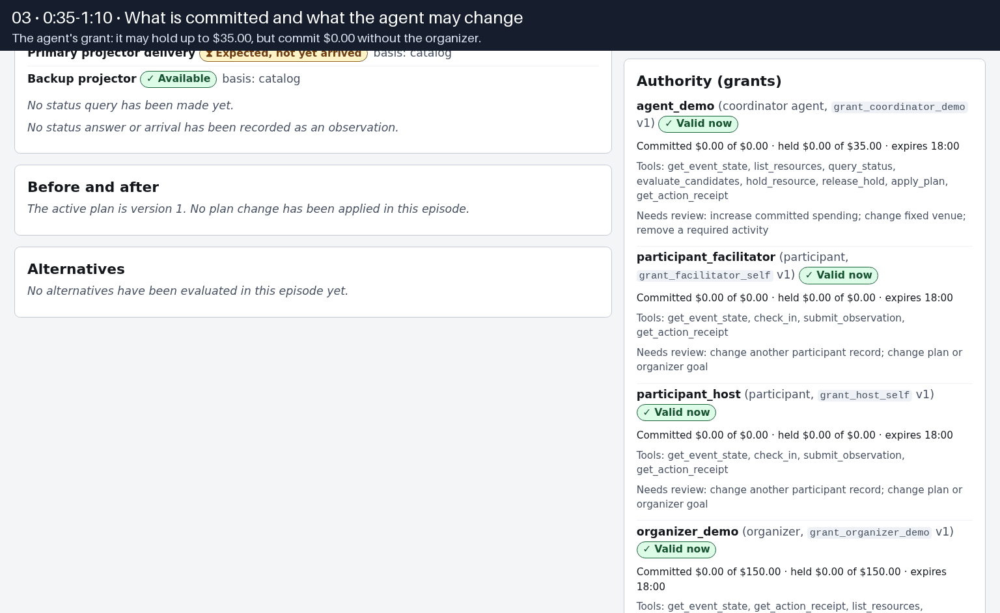

- **Clicks:** scroll to *Current schedule (plan version 1)*, then to *Authority (grants)*.
- **Point at:** the demonstrations need the "Primary projector delivery", which is "Expected,
  not yet arrived". Then the `agent_demo` grant: "Committed $0.00 of $0.00 · held $0.00 of
  $35.00", with its tool list.
- **Say:** "Until four minutes in, the coordinator you see is our rule-based baseline: the badge
  says 'Deterministic policy'. The language model comes later. The agent can check sources,
  evaluate options and place a refundable hold of up to $35. It cannot spend a cent without the
  organizer."

### 1:10–2:25 · The delayed projector: verify, then commit (75 s)

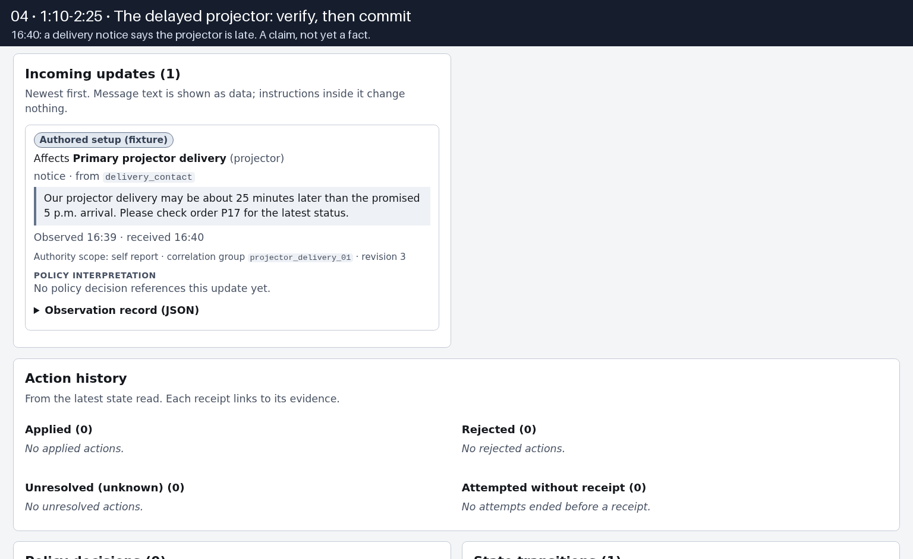
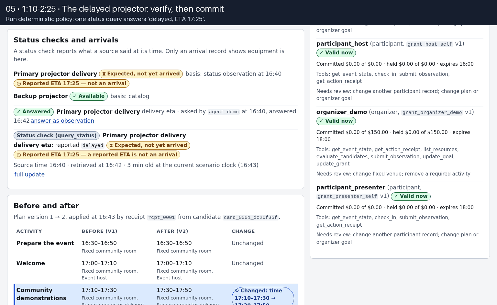
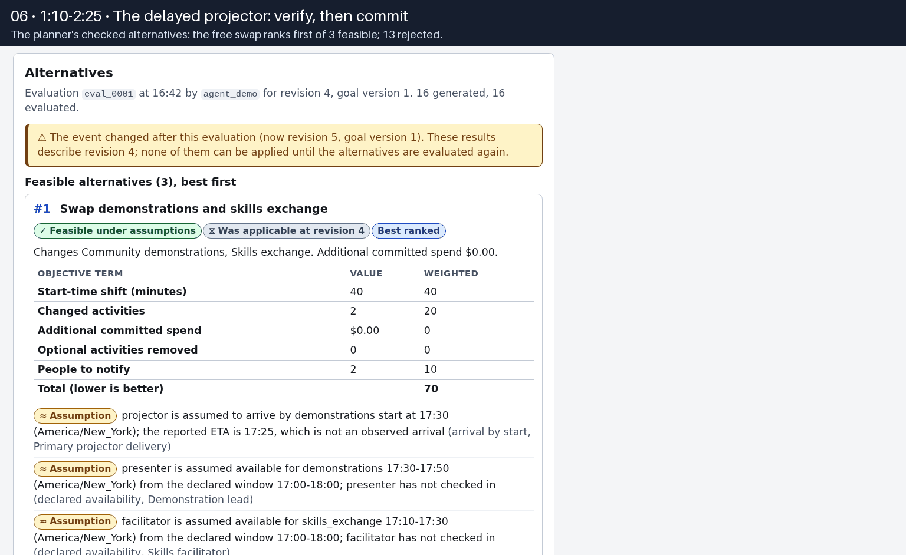
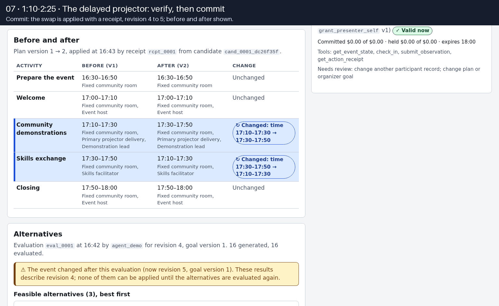

- **Clicks:** scroll to *Incoming updates* and show the notice. Then click **Run deterministic
  policy** once. The run verifies and commits in one click, and stops when it would only wait.
- **Point at, in order:**
  1. *Incoming updates*: "Our projector delivery may be about 25 minutes later…", from
     `delivery_contact`, observed 16:39, received 16:40.
  2. *Status checks and arrivals*: "Answered … delivery eta: reported delayed", "Reported ETA
     17:25 — a reported ETA is not an arrival".
  3. *Alternatives*: "#1 Swap demonstrations and skills exchange", "Additional committed spend
     $0.00", and "Rejected alternatives (13)".
  4. *Before and after*: "Plan version 1 → 2, applied at 16:43 by receipt `rcpt_0001`".
     Demonstrations move 17:10–17:30 → 17:30–17:50.
- **Say:** "A message is a claim, not a fact. One status query confirms the delay. The planner
  checks every option against deadlines, people and budget. The free swap is applied, and here is
  its receipt: revision 4 to 5."
- **Rough edge:** after the commit, *Alternatives* shows an amber note: "The event changed after
  this evaluation (now revision 5…)". That is correct, because the evaluation describes revision 4.
  Say "that list is from before the change".

### 2:25–3:10 · A stale warning and its duplicate, without churn (45 s)

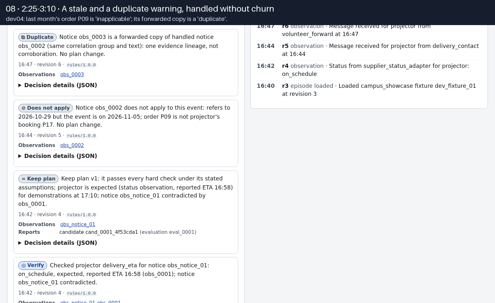

- **Clicks:** Case `dev04` → **Reset: load a clean episode…** → **Close it and load case
  dev04** → **Run deterministic policy**. Then set *Minutes* to `8` → **Run 8 minutes with policy**
  (fast-forward to 16:50).
- **Point at:** *Policy decisions*:
  - "Does not apply": "Notice obs_0002 does not apply to this event: refers to 2026-10-29 but
    the event is on 2026-11-05; order P09 is not projector's booking P17. No plan change."
  - "Duplicate": "Notice obs_0003 is a forwarded copy of handled notice obs_0002 … one evidence
    lineage, not corroboration."
  - "Keep plan v1". The status check said "on_schedule, ETA 16:58".
- **Say:** "Last month's order number and the wrong date: the warning does not apply. A volunteer
  forwards it again; one source repeated is still one source. Nothing is held, nothing is spent,
  and the plan stays at version 1."

### 3:10–4:00 · Prepare, ask, commit: the organizer-approved paid backup (50 s)

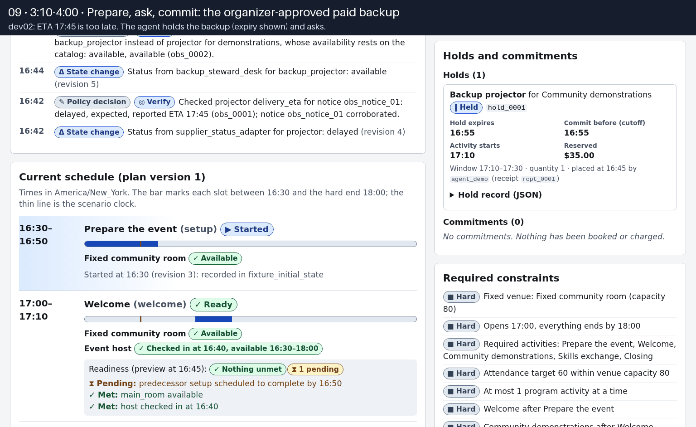
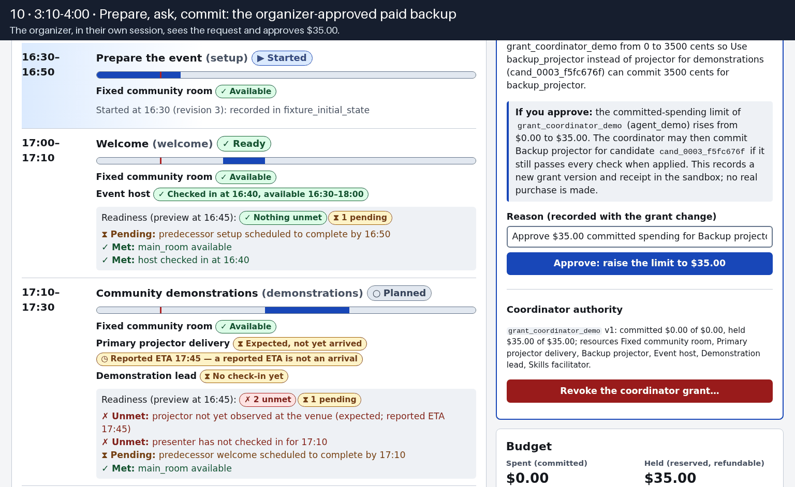
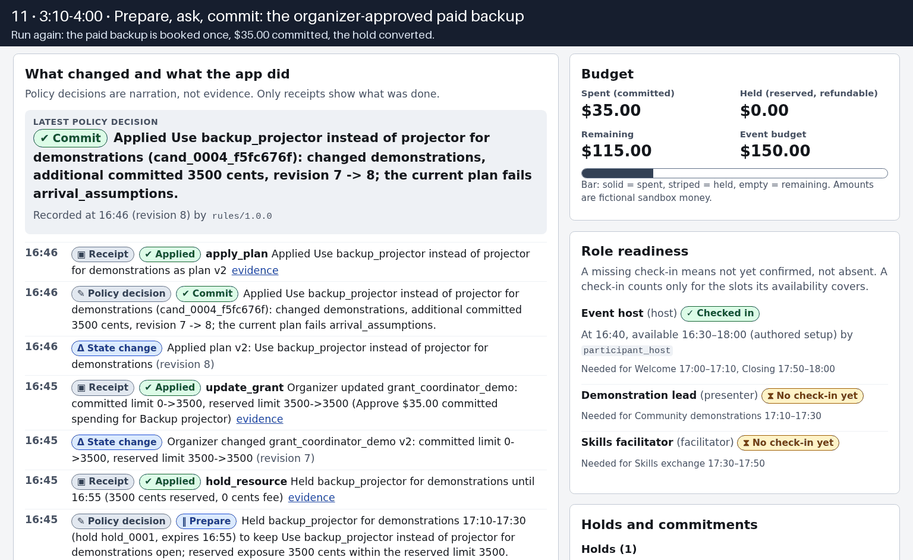

- **Clicks:**
  1. Case `dev02` → reset and load → **Run deterministic policy**.
  2. **Role sessions** → `organizer_demo` → **Issue join code** → **Open in new tab**.
  3. In the organizer tab: **Approve: raise the limit to $35.00** (click **Confirm** if it
     appears).
  4. Back in T1: **Run deterministic policy**.
- **Point at:**
  1. *Holds and commitments*: "Backup projector … Held `hold_0001`, Hold expires 16:55, Commit
     before (cutoff) 16:55, Reserved $35.00".
  2. The latest decision: "Ask organizer … from 0 to 3500 cents … hold hold_0001 keeps the option
     open until 16:55".
  3. In the organizer tab, "If you approve: … no real purchase is made".
  4. After the second run, *Budget*: "Spent (committed) $35.00, Held $0.00". *What changed*: the
     `apply_plan` receipt "as plan v2".
- **Say:** "Now the projector says 17:45, too late for either slot. The agent prepares: a free hold
  on the backup that expires at 16:55. It cannot spend, so it asks. The organizer approves in their
  own session; only then is the backup booked, once."
- **Rough edge:** the commit summary ends "the current plan fails arrival_assumptions". Read it
  as "because the old plan relied on the projector arriving in time".

### 4:00–4:55 · The live LLM coordinator's decision card (55 s, Recorded replay)

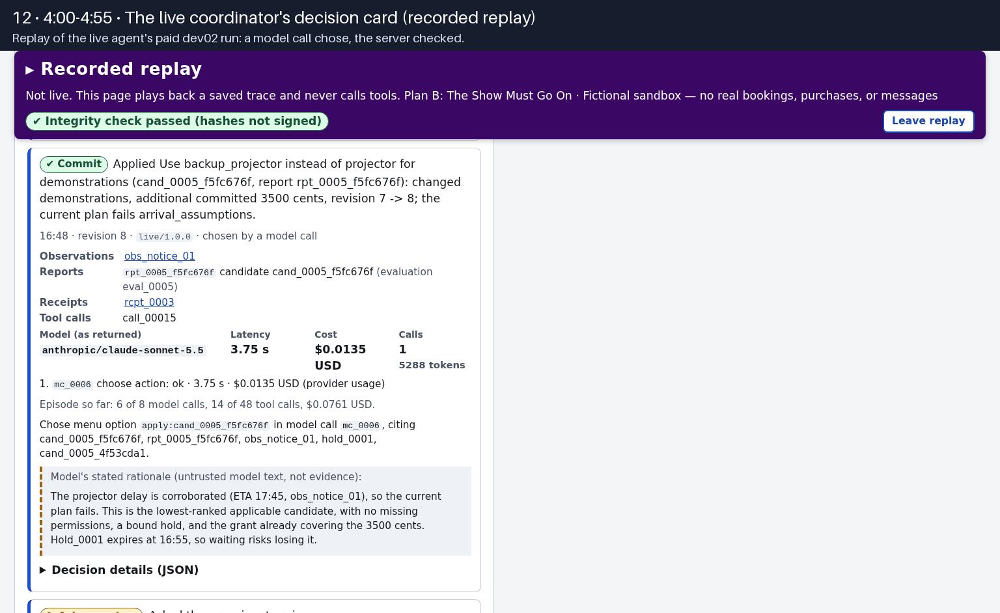
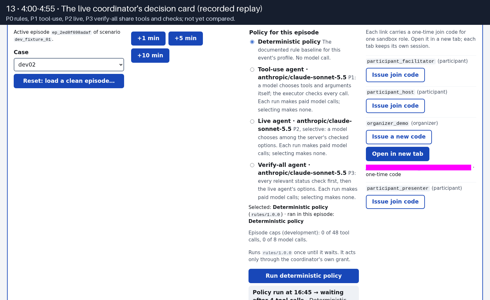
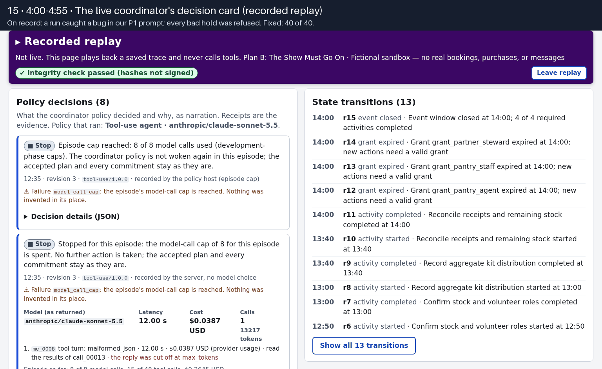

Backup frame, only for a question: P3's own checks are labeled as server checks (in T2, open
`#/replay/live_p3-verify-all_dev02_trace.json` → **Final recorded state**).

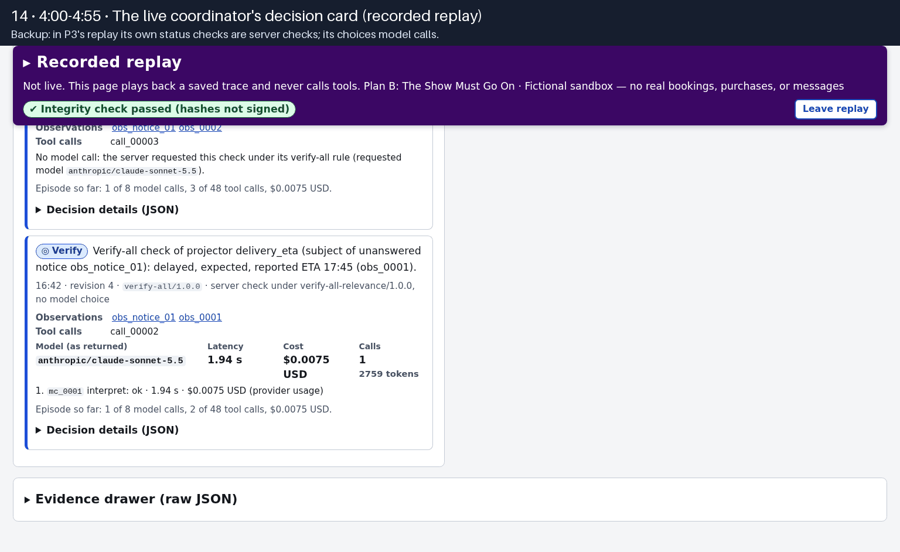

- **Clicks:** switch to **T2**. Say: "This is a recorded replay of a real paid run, not live." Show
  the **Commit** card. Then, for 5 s, show T1's *Coordinator policy* selector. Then switch to **T3**
  and show *Policy decisions*. Then, for 3 s, open its fixed rerun in the same tab
  (`#/replay/live_p1-tool-use_pantry_dev01_r2_trace.json` → **Final recorded state**):
  `tool-use/1.0.0`, "40 of 40 on time". The screen itself says nothing about the fix, so show it.
- **Point at (T2):** the "Recorded replay" banner and "Integrity check passed"; `live/1.0.0 ·
  chosen by a model call`; "Model (as returned) anthropic/claude-sonnet-5.5"; latency 3.75 s;
  cost $0.0135; "Episode so far: 6 of 8 model calls"; "Chose menu option apply:cand_0005_f5fc676f
  in model call mc_0006"; receipt `rcpt_0003`. The rationale box says "untrusted model text, not
  evidence".
- **Point at (T1):** the four choices: Deterministic policy (the rule baseline, P0 in our plan),
  Tool-use agent (P1), Live agent (P2, selective), Verify-all agent (P3). "Selecting makes none
  [no model calls]."
- **Point at (T3):** `tool-use/1.0.0`, six "hold_resource was rejected (…)" cards (three
  `INVALID_REQUEST`, three `CONSTRAINT_VIOLATION`), "Stop … the model-call cap of 8 for this episode is spent", and
  "0 of 40 on time", with stock conserved. The executor refused every malformed hold, and nothing
  was invented.
- **Say:** "Here a language model picks the next step, but only from options the server built and
  checked; the receipt is the evidence, not the model's rationale. We built three model-driven
  policies with the same tools, grants and checks, and have not compared them yet. One
  development run failed, and we keep it on record: it caught a bug in *our* P1 (tool-use)
  harness, whose prompt never said which time window a hold covers. The executor refused every
  bad hold. We fixed the prompt and its token limit, and the rerun served all 40 kits."
- **Optional functional readout** (a count, not a comparison): "Fifteen current development
  runs, P1 to P3 on five cases, one trial each, all matched their expected outcomes. Five
  superseded P1 runs, the failure just shown among them, are kept on record."
  Source: `apps/plan_b/plan_b/evaluation/development/README.md`. Do not break it down by
  policy, and do not turn it into a rate.
- **A second honest limit, for questions:** P1 treats every new observation as material. It
  spent model calls confirming "keep" and reached its 8-call cap after its plan was already in
  place, in three of its five current runs (dev01 at 17:24, dev02 at 17:44, skills_dev01 at
  10:06), so a later disruption would have gone unanswered. This is a harness design choice to settle before the Wave 3 freeze.
- The mechanism, in one breath: interpret → verify if it could change the decision → prepare a
  reversible hold → commit only a checked plan → receipt → next decision.

### 4:55–5:40 · A participant's own check-in changes the plan (45 s)

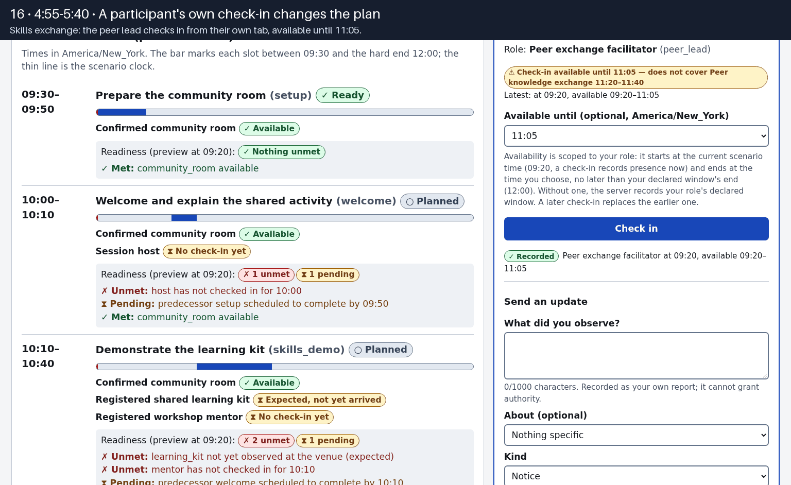
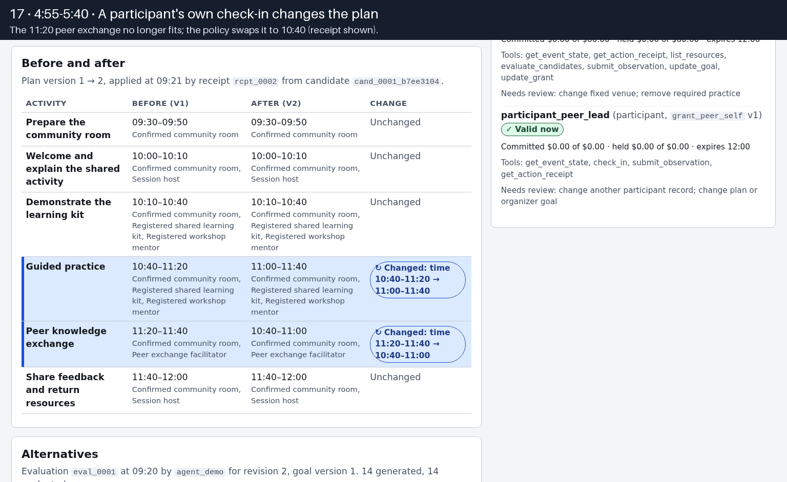
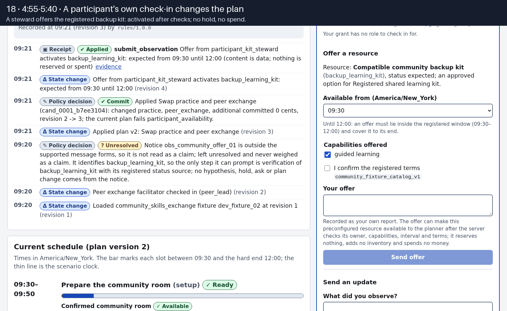

- **Clicks:**
  1. Case `skills_dev01` → reset and load.
  2. **Role sessions** → `participant_peer_lead` → **Issue join code** → **Open in new tab**.
  3. In the peer-lead tab: *Available until* `11:05` → **Check in**.
  4. Back in T1: **Run deterministic policy**.
  5. Optional, only if ahead of time: `participant_kit_steward` → its tab → tick **I confirm the
     registered terms** → type the offer → **Send offer**.
- **Point at:**
  1. The peer tab: "Check-in available until 11:05 — does not cover Peer knowledge exchange
     11:20–11:40".
  2. T1 *Before and after*: "Plan version 1 → 2 … by receipt `rcpt_0002`". Peer knowledge
     exchange moves 11:20–11:40 → 10:40–11:00, and Guided practice 10:40–11:20 → 11:00–11:40.
  3. For the offer: "Offer from participant_kit_steward activates backup_learning_kit … nothing
     is reserved or spent".
- **Say:** "A different event, the community skills exchange, on the same engine and the same
  rule baseline. The peer lead says, from their own session, that they must leave at 11:05. That one fact makes the old plan
  infeasible, and the swap fixes it. A participant can report their own availability; they cannot
  change anyone else's or the goal."

### 5:40–6:25 · Pantry Continuity cameo (45 s)

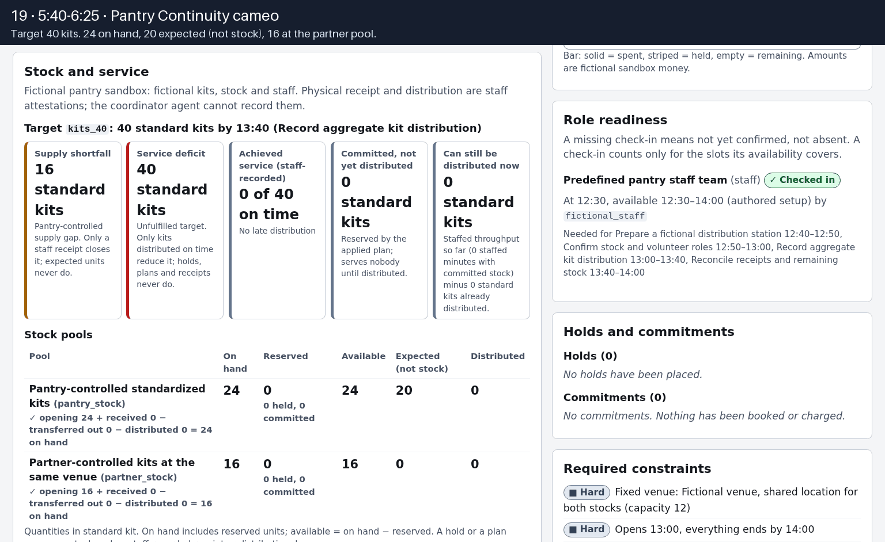
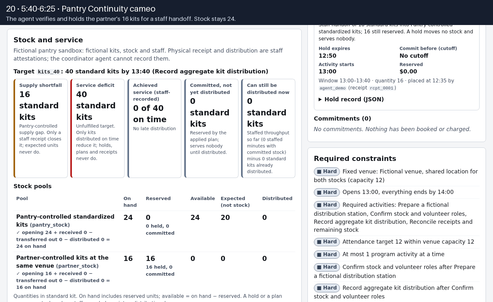
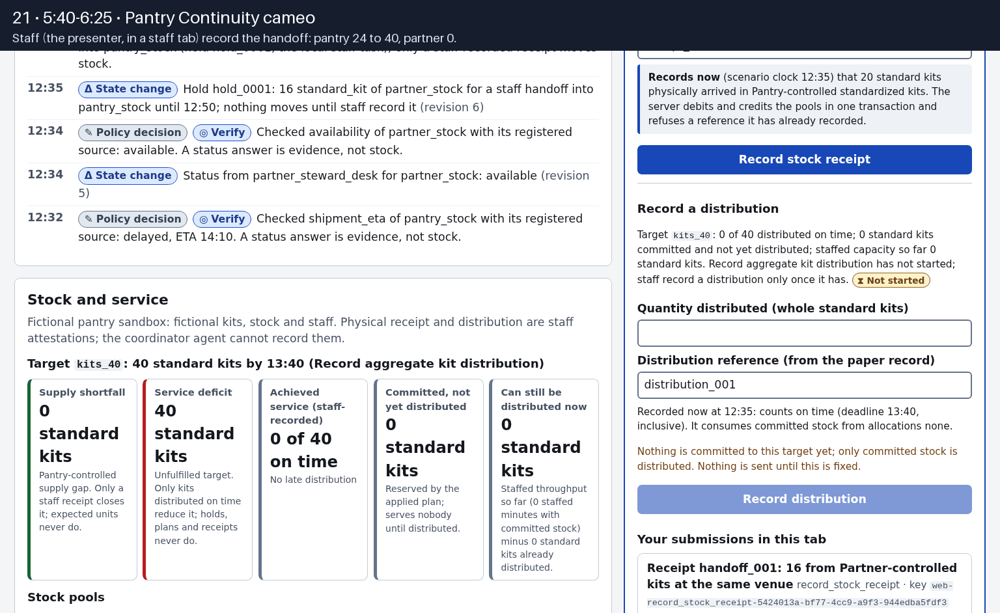
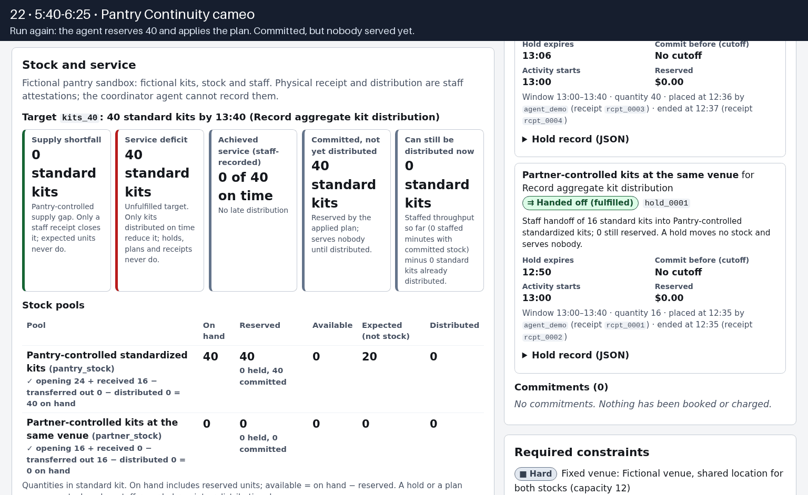
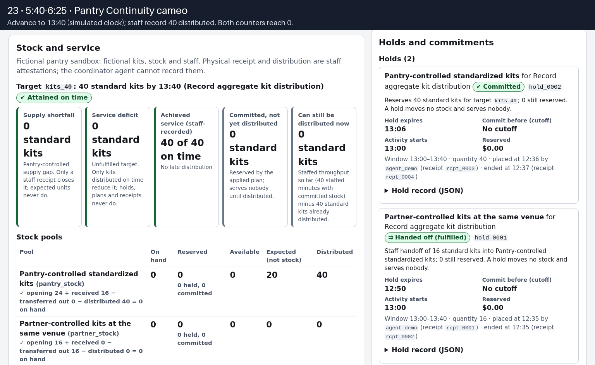

- **Clicks:**
  1. Case `pantry_dev01` → reset and load (clock 12:30).
  2. **Role sessions** → `fictional_staff` → **Issue join code** → **Open in new tab**.
  3. T1: **Run deterministic policy**.
  4. Staff tab: wait until *What arrived* shows the hold, then click **Record stock receipt**
     once and wait for "Applied" under *Your submissions in this tab*. The form then reads
     "Choose what arrived" and its button is disabled: it never moves on to "Shipment S20: 20
     outstanding" by itself, so a second click records nothing.
  5. T1: **Run deterministic policy**.
  6. T1: *Minutes* = 13:40 minus the clock in the header. The automated run typed the value in
     the rehearsal record below. Then **Run N minutes with policy** (fast-forward).
  7. Staff tab: wait for "Recorded now at 13:40" and *Quantity distributed* `40`, then **Record
     distribution**.
- **Point at:** "Fictional pantry sandbox"; "Target `kits_40`: 40 standard kits by 13:40"; and
  the counters, in this sequence:

  | Moment | Supply shortfall | Service deficit | Pools |
  | --- | --- | --- | --- |
  | Loaded | 16 | 40 | pantry 24 (expected 20, not stock), partner 16 |
  | Held | 16 | 40 | partner reserved 16; pantry still 24 |
  | Staff handoff | 0 | 40 | pantry 40, partner 0 |
  | Committed | 0 | 40 | "Committed, not yet distributed" 40; "0 of 40 on time" |
  | Distributed | 0 | 0 | "40 of 40 on time", "Attained on time"; S20 still 20 expected |

- **Say:** "Same loop, a new quantity rule. Staff need 40 kits; 24 are here; 20 more are late and
  do not count. The coordinator verifies and holds 16 kits from the partner pool at this venue.
  Only staff can record the physical handoff: the supply shortfall is now zero, but nobody has been
  served. Fast-forward to 13:40: staff record the distribution, and only that brings the service
  deficit to zero."

### 6:25–7:00 · Close (35 s)

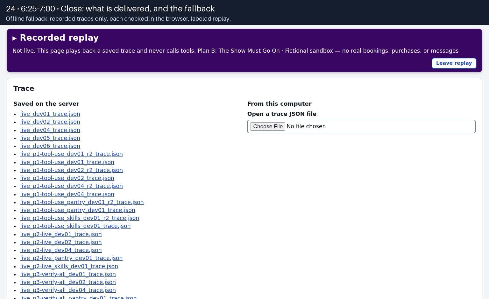

- **Say:** "Today Plan B verifies, prepares and commits changes in a bounded sandbox. Every
  action has a receipt, and people approve spending and attest physical events. The live agent
  ran end to end on our development cases. We have not run the comparison yet; that is next, on
  held-out cases with repeated trials. The next step is to review these workflows with community
  staff. We claim no partnership."

## 5. If the model endpoint fails mid-demo

This applies only to the optional live mode. The default plan already uses the replay.

1. If nothing visible changes 20 s after **Run live agent**, switch. The recorded dev01 runs spent
   about 10.7 s of model latency over 3 calls, so 20 s is about twice that. A failure that does
   reach the board shows as a decision card such as "Failure `provider_timeout`: the model
   provider did not answer in time. Nothing was invented in its place." That is fine to point at.
   The audit checked an unreachable endpoint: one press returned in 0.3 s with a *Wait* card,
   "Failure `provider_error`: the model provider failed or could not be reached", and the plan,
   holds and budget unchanged; a clean reload, the deterministic run and the replays then
   worked.
2. Say: **"We are switching to a recorded run of the same scenario."** Then switch to T2. Its
   purple "Recorded replay" banner stays on the page.
3. Never leave the live badge on screen over a replay. Never describe a replay as live, and never
   retry until it succeeds on stage.
4. Return to T1 and continue with the deterministic policy. To leave a live-policy episode, load
   a clean episode. The policy is fixed once the coordinator has acted in an episode.

## 6. Offline fallback (no server, or the board misbehaves)

- **Replays.** These are recorded traces only, each checked in the browser ("Integrity check
  passed"), with the purple "Recorded replay" banner on every page. Replay never calls a tool (it
  sends no POST, PUT or DELETE request, a storyboard and walkthrough check).
  - Campus, live agent: `live_p2-live_dev01_trace.json` (verify, then swap) and
    `live_p2-live_dev04_trace.json` (stale and duplicate).
  - Paid backup: `live_p2-live_dev02_trace.json`.
  - Pantry: `pantry_dev01_trace.json` (deterministic run) or `live_p2-live_pantry_dev01_trace.json`
    (the live agent's run, 40 of 40 on time).
  - Community: `skills_dev01_trace.json`.
  - Use **Play**, or the arrow keys, to step through frames. Say "recorded" each time you switch.
- **Last resort.** Show the storyboard frames in this file. Call them "frames from an automated
  dry run", not a live demo.
- A replay is never a new trial. It does not prove the server would behave the same on stage.

## 7. Claims and their evidence

Paths are relative to this packet unless they start with `apps/`.

| The demo shows or says | Evidence |
| --- | --- |
| The campus recovery: one status query, a checked free swap, receipt `rcpt_0001` at revision 4 → 5 | `evidence/storyboard/storyboard_report.json` (steps 4–7); `evidence/reports/checks.json` (dev01 line); `evidence/screenshots/walkthrough_report.json` |
| The stale P09 notice is inapplicable and its copy a duplicate; plan v1 kept, no hold or spend | `storyboard_report.json` step 8; dev04 line in `checks.json`; live: `evidence/reports/live_dev04_run.json` and `live_p2-live_dev04_run.json` |
| The paid backup: a free hold with expiry, an organizer approval, one commitment of $35.00 | `storyboard_report.json` steps 9–11; dev02 line (`committed=3500`) in `checks.json`; `walkthrough_report.json` ("authorized paid backup booking committed once") |
| The live agent's decision card: a model call chose, the server validated, with cost and latency | `evidence/traces/live_p2-live_dev02_trace.json` (sha256 `fd06e4b7…`, `intact`); `evidence/reports/live_p2-live_dev02_run.json` (6 model calls, $0.07613, matches expectation); `storyboard_report.json` step 12 |
| P1, P2 and P3 exist and share the tools, grants, candidates and executor | `apps/plan_b/tests/test_policy_parity.py`, `apps/plan_b/tests/test_live_workflow.py`; the selector in `storyboard_report.json` step 13 |
| P3's own checks are server checks (`verify-all-relevance/1.0.0`) | `evidence/traces/live_p3-verify-all_dev02_trace.json`; `storyboard_report.json` step 14; `apps/plan_b/web/tests/demo_story.test.ts` |
| A failed development run kept on record: P1's first live pantry run had 6 refused holds, reached the 8-model-call cap and served 0 of 40, because of a defect in our P1 harness (prompt v1, token budget). It was fixed with `tool_use.v2`, and the rerun served 40 of 40 | `evidence/reports/live_p1-tool-use_pantry_dev01_run.json` ($0.26454) and `…_outcome.public.json`; `live_p1-tool-use_pantry_dev01_r2_run.json` ($0.15995); `apps/plan_b/plan_b/evaluation/development/README.md` ("Superseded runs"); `storyboard_report.json` step 15 (and the rerun check) |
| Optional readout: 15 current development runs of P1–P3 on 5 cases match their expected outcomes (one trial each) | `apps/plan_b/plan_b/evaluation/development/README.md` |
| The first Wave 2 live pantry run served 0 of 40 (no stock options then); P2's pantry run with the finishing step's code served 40 of 40 on time | `evidence/reports/live_pantry_dev01_run.json`; `evidence/reports/live_p2-live_pantry_dev01_run.json` ($0.045208) |
| A participant's own check-in (until 11:05) makes the plan infeasible, and the swap fixes it | `storyboard_report.json` steps 16–17; `evidence/traces/skills_dev01_trace.json`; `evidence/screenshots/walkthrough_wave2_report.json` (community flow) |
| An offer activates a preconfigured kit with no hold, spend or plan change | `storyboard_report.json` step 18; `walkthrough_wave2_report.json` |
| Pantry 24/16 → 40/0 through one staff receipt; the target stays 40; only distribution reduces the service deficit; stock is conserved | `storyboard_report.json` steps 19–23; `evidence/reports/pantry_accounting.json`; `traces/pantry_dev01_trace.json` |
| The agent cannot record receipts or distributions (staff-only tools) | VERIFICATION.md section 3 ("Staff boundary"); `apps/plan_b/tests/test_stock_conservation.py` |
| The storyboard made no model call | `storyboard_report.json`, the closing check (5 episodes, only `rules/1.0.0` and `pantry-rules/1.0.0` decided, 0 model calls) |

### Do not claim

- **No comparative result.** Do not say, or imply with a chart, that P2 beats P1 or P3, or the
  deterministic baseline. The current P1 runs use `tool_use.v2`; its five superseded runs used
  `tool_use.v1`.
- **The P1 pantry failure is not a weakness of tool use or of the model.** It was a defect in
  our harness, now fixed. Present it only as "a development run caught our bug; it is kept on
  record".
- **Development runs only.** Every case is a development case, each live case ran once, and
  nothing is held-out evaluation. Do not quote completion rates; the optional readout in
  section 4 is a count of single trials, with the superseded runs named.
- **Fictional sandbox.** It has no real bookings, purchases, messages, rooms, people or stock.
  The November dates are fictional.
- **No real pantry, no U-ACCESS involvement.** Do not imply that U-ACCESS staff, systems,
  inventory or partners took part. `partner_stock` is not a real partner. There are no recipient
  identities and no eligibility, allergen or medical decisions. The demo's 40-kit numbers are
  scenario assumptions, not measured throughput.
- **Not community validation.** No participant gave feedback.
- **The rationale is not an explanation.** The model's text is labeled untrusted, and it
  sometimes misstates details. For example, the commit card calls the rank-1 candidate "the
  lowest-ranked applicable candidate". The receipts
  and checks are the evidence.
- Do not say "always safe", "proven reliable", "zero-shot transfer", "optimal" or "first ever".
- Do not present the optional live mode as rehearsed unless a human rehearsal on the stage
  machine actually succeeded.

## 8. Reset checklist between rehearsals

1. Stop the server (Ctrl+C in its terminal).
2. `uv run python scripts/demo_prep.py`. This removes and recreates `var/demo`: a fresh database,
   no sessions, and the replays copied again and re-verified. It refuses to delete any directory
   it did not create.
3. Start the server again (section 3) and sign in on T1 before projecting.
4. Close every old role tab. Their sessions are gone after the reset anyway.
5. Reload T2–T4 and click **Final recorded state** in T2 and T3.
6. Check the header of T1: "Deterministic policy · selected, not run yet" and state revision 3
   after loading `dev01`.
7. If the optional live mode is used, check the ledger total and the caps before and after, and
   reset the per-episode selection by loading a clean episode.
8. Browser zoom 125 %; notifications off; T1 scrolled to the top.

## 9. Rehearsal record: one timed automated internal dry run

This is **not a human rehearsal**. It is one automated run of `tests/e2e/storyboard.py`:
headless Chromium on the development machine, a clean `demo_prep` state, and a local port. The
run timed the app work only (loading, clicks, policy runs, waiting for the board), with no
speaking. A human presenter still needs three uninterrupted timed rehearsals (09's preflight),
including one forced provider failure if the live mode is used.

The run recorded here is the integration step's collector run, from a clean checkout of
`c4f7cd9`: it wrote `evidence/storyboard/` (24 frames and `storyboard_report.json`), and the
table below is read from that committed report. Result: **32/32 checks passed**, exit 0. The
demo worker's run and the audit step's run (07:49Z) gave the same counts, with timings that
differ by tenths of a second. The closing checks found no model call (5 episodes, only
`rules/1.0.0` and `pantry-rules/1.0.0` decided), no page error, no horizontal overflow at
1536 px, and no join code or session token in the visible text of any frame (join links
masked).

| Segment | Planned (s) | Automated app time (s) | Frames | Checks |
| --- | --- | --- | --- | --- |
| 0:00-0:35 The campus showcase | 35 | 2.0 | 1 | 1/1 |
| 0:35-1:10 What is committed and what the agent may change | 35 | 1.0 | 2 | 2/2 |
| 1:10-2:25 The delayed projector: verify, then commit | 75 | 2.3 | 4 | 4/4 |
| 2:25-3:10 A stale and a duplicate warning, handled without churn | 45 | 6.0 | 1 | 2/2 |
| 3:10-4:00 Prepare, ask, commit: the organizer-approved paid backup | 50 | 10.4 | 3 | 3/3 |
| 4:00-4:55 The live coordinator's decision card (recorded replay) | 55 | 3.0 | 4 | 7/7 |
| 4:55-5:40 A participant's own check-in changes the plan | 45 | 7.4 | 3 | 3/3 |
| 5:40-6:25 Pantry Continuity cameo | 45 | 8.3 | 5 | 5/5 |
| 6:25-7:00 Close: what is delivered, and the fallback | 35 | 0.5 | 1 | 5/5 |
| **Total** | **420** | **40.9** (whole script 41.7 s, server start to stop) | **24** | **32/32** |

What the run says about the live demo:

* **The app is never the bottleneck.** In every segment, the clicks and waits took at most about 10.4 s of
  the planned time. The slowest steps were `stale_and_duplicate` (6.0 s), `backup_held_and_asked` (5.2 s)
  and `community_replanned` (4.7 s). In those steps the server runs the policy or
  fast-forwards the clock, and the board polls every 1.5 s.
* **The time goes to talking and switching tabs.** The busiest segments for a person are the
  paid backup (an organizer tab), the community segment (one or two participant tabs) and the
  pantry (a staff tab). In the pantry run the fast-forward to 13:40 was 63 minutes, from 12:37.
  Read the clock in the header and type the difference.
* **Fragile points, handled by waiting for the board.** A role tab acts on its last 1.5-second
  poll. Wait until the board shows the change (for example *What arrived* showing the hold, or
  "Recorded now at 13:40" with quantity 40) before clicking. A `REVISION_CONFLICT` means the tab
  was a poll behind. The rejected request changed nothing, so wait a moment and click the same
  button again.
* **The talk track, counted.** At about 150 words a minute, the spoken lines of 4:00–4:55 are
  about 100 words (about 40 s of its 55 s, leaving about 15 s for three tab switches), and the
  close is 67 words (about 27 s of 35 s). The audit shortened both; do not add to them.
* **Not tested here:** the human talk track, a projector, audio and keyboard-only operation. The
  optional live mode and a provider failure were checked once each by the audit (sections 2 and
  5), not rehearsed.

## 10. Presentation changes made for this runbook

These are small web changes under `apps/plan_b/web/src/`, tested in `web/tests/demo_story.test.ts`:

- **Decision cards.** Cards from every model-driven policy (`tool-use/`, `live/`, `verify-all/`)
  now show "chosen by a model call", the model block (model, latency, cost) and the model styling.
  Before, only `live/` did. P3's own checks read "server check under verify-all-relevance/1.0.0,
  no model choice". A P1 turn shows the tools the model named and its untrusted rationale.
- **Hold cards** show the hold id next to "Hold expires" and the cutoff. 09 asks for the hold's
  identifier and expiry.
- **The pantry board** uses the presentation's terms: "Fictional pantry sandbox", "Supply
  shortfall" and "Service deficit". The counter notes are shorter, and the grid fits the counters
  and the stock pools on one projector screen.
- **State transitions.** Each row keeps its revision, cause and summary in one cell. Before, the
  cause label overlapped the summary.
- **Model block.** The returned model id is no longer broken mid-name.
- **Audit step.** The pantry tile "Staffed capacity so far" now reads "Can still be distributed
  now", with a note that says it is staffed throughput minus what is already distributed. The
  live board badge is blue, no longer the replay's purple. A `provider_error` card says the
  provider "failed or could not be reached", which covers a refused connection. The storyboard
  places each card directly under the replay banner and shows the organizer at the deck's size.
- **Integration step.** Once the handoff is recorded, the staff receipt form no longer falls
  back to the S20 shipment: it shows the next open handoff, or nothing until staff pick a source
  (`web/tests/staff_receipt.test.ts`).
