# Evaluation results

Generated by `plan-b eval report` from one results directory: suite **campus**, held-out, 59 of 80 planned episodes recorded (8 cases × policies P0, P1, P2, P3). Descriptive counts only: no composite score and no significance test. A blank cell (—) means not measured, not zero.

## Run manifest

- Code commit: 49e62b5a86fa64c2454586dcb20c28590b763e0a (apps/plan_b tree clean: yes; measured files 7d41fada702f2172c39a968bb6a2a1d72b6cac4e6d23cb047133d47ce373596f)
- Suite: primary campus (campus)
- Scenario-set version and hash: held-out lock files_sha256 86ea09c089d2ea3bcd936eca6535de773847095e248f78b6434fa44200685055
- Case IDs: C02, C05, C03, C07, C01, C06, C04, C08
- Protocol version: plan_b.eval_protocol/1.0.0
- Policy identifiers: live/1.1.0, rules/1.0.0, tool-use/1.1.0, verify-all/1.1.0 (P0, P1, P2, P3)
- Model identifier and serving configuration: requested anthropic/claude-sonnet-5.5 via openrouter; returned anthropic/claude-sonnet-5.5
- Measured code (prompts, parser, planner, adapters, tool registry): freeze verified, files_sha256 7d41fada702f2172c39a968bb6a2a1d72b6cac4e6d23cb047133d47ce373596f
- Candidate generation, registry, grants and tools: the same frozen code and fixture for every policy within a case
- Tool limits, retries, timeouts: 48 tool calls and 8 model calls per episode (frozen caps); episode timeout 900 s of wall time; retry rules as frozen
- Scenario clock and random seeds: seeds [101, 202, 303]; policy-order seed 20261025
- Provider seed support: seed passed to run_case; NOT sent to the provider (the model's endpoints refuse a seed): the trials are independent runs, not reproducible ones
- Shared exogenous observations and staff responses: each case's frozen private case, identical for every policy
- Number of independent cases: 8
- Repeated model runs per case: 3 per model policy; P0 once
- Failed or incomplete runs and treatment: 0 timed out, crashed or with a trace that no longer matches its record (failures in the outcome-class shares; the other aggregates are over scored episodes, whose number each table names); 0 aborted by the harness (the cumulative spend cap or the endpoint configuration: not scored, rerun by a resume); 21 planned episodes missing (listed below)
- Run order: shuffled within each case over all four policies from the order seed (plan.json); run created 2026-10-25T16:22:46Z
- Analysis changes after inspecting outcomes: none made by this tool; record any here

## Primary campus aggregate display

| Policy | Goal completion C01–C07 | Appropriate infeasibility C08 | Invalid attempts / executed violations | Unnecessary changes C02–C04 | Recovery time | Tool calls | Modeled cost | Incomplete runs |
| --- | --- | --- | --- | --- | --- | --- | --- | --- |
| P0 rules | 4/6 | — | 0 / 0 (6 scored) | 0 in 0/2 episodes | 2/4 recovered; median ≥50.5 min (recovered only: median 14, range 3–25) | 147 | 0 cents | 0 (+0 aborted, +2 missing) |
| P1 tool use | 6/17 | — | 0 / 0 (17 scored) | 0 in 0/6 episodes | 0/11 recovered; median ≥77 min (recovered only: median —, range —–—) | 316 | 0 cents | 0 (+0 aborted, +7 missing) |
| P2 selective | 7/18 | — | 0 / 0 (18 scored) | 0 in 0/6 episodes | 1/12 recovered; median ≥77 min (recovered only: median 3, range 3–3) | 238 | 0 cents | 0 (+0 aborted, +6 missing) |
| P3 verify-all | 6/18 | — | 2 / 0 (18 scored) | 0 in 0/6 episodes | 0/12 recovered; median ≥77 min (recovered only: median —, range —–—) | 246 | 0 cents | 0 (+0 aborted, +6 missing) |

Completion columns are episodes meeting the case's outcome class over recorded episodes of that class (a timed-out or crashed episode counts as not met); for infeasibility, who chose the reporting decision (the model, the server's shared narration, or the deterministic policy). Unnecessary changes are applied plan changes on the designated negative controls, whose original plan the evaluator's replay confirmed feasible. Recovery time is simulated minutes from the first actionable update to the first applied plan change; the median counts an unrecovered episode at its horizon (≥: a lower bound), and the median among recovered episodes is shown beside it. Modeled cost is committed event money, hold fees included, separate from computation cost.

## Counts and denominators

| Policy | Planned | Recorded | Scored from state | Capped | Timed out | Crashed | Trace failed | Aborted (harness) | Missing | Outcome classes (met / recorded) |
| --- | --- | --- | --- | --- | --- | --- | --- | --- | --- | --- |
| P0 rules | 8 | 6 | 6 | 0 | 0 | 0 | 0 | 0 | 2 | Goal completion 4/6 |
| P1 tool use | 24 | 17 | 17 | 17 | 0 | 0 | 0 | 0 | 7 | Goal completion 6/17 |
| P2 selective | 24 | 18 | 18 | 16 | 0 | 0 | 0 | 0 | 6 | Goal completion 7/18 |
| P3 verify-all | 24 | 18 | 18 | 15 | 0 | 0 | 0 | 0 | 6 | Goal completion 6/18 |

## Verification, churn, preparation and computation

Over the scored episodes. Plan churn is committed revisions plus the previously valid assignments they altered (an assignment the kept plan already failed a hard check on in the planner's evaluation before the change is a repair, not churn).

| Policy | Status checks | Distinct sources | Repeated | Failed | Simulated minutes | Plan churn | Preparation cost | Computation |
| --- | --- | --- | --- | --- | --- | --- | --- | --- |
| P0 rules | 6 | 5 | 1 | 1 | 12 | 4 | 0 holds, 0 min, 0 cents in fees (part of committed money), 0 expired, 0 unreleased | 6 episodes measured: 0 calls (0 retries, 0 failed); 0+0 tokens; 0 ms; 0.0000 USD |
| P1 tool use | 7 | 7 | 0 | 0 | 14 | 0 | 0 holds, 0 min, 0 cents in fees (part of committed money), 0 expired, 0 unreleased | 17 episodes measured: 136 calls (0 retries, 129 failed); 91167+3731 tokens; 53293 ms; 0.2196 USD |
| P2 selective | 6 | 6 | 0 | 0 | 12 | 2 | 0 holds, 0 min, 0 cents in fees (part of committed money), 0 expired, 0 unreleased | 18 episodes measured: 137 calls (0 retries, 119 failed); 67299+4390 tokens; 80006 ms; 0.1785 USD |
| P3 verify-all | 14 | 12 | 2 | 0 | 28 | 0 | 0 holds, 0 min, 0 cents in fees (part of committed money), 0 expired, 0 unreleased | 18 episodes measured: 129 calls (0 retries, 114 failed); 43961+3391 tokens; 69075 ms; 0.1218 USD |

## Per-case display

| Case | Policy | Seed/run ID | Final original-goal status | Invalid attempts / violations | Plan edits | Verification calls | Actual model/tool cost | Outcome note | Trace |
| --- | --- | --- | --- | --- | --- | --- | --- | --- | --- |
| C01 | P0 | once | Goal completion: yes | 0 / 0 | 1 | 2 | 0 model / 29 tool calls; 0.0000 USD | met | episodes/hk_m2q__P0__once/trace.json.gz |
| C01 | P1 | 101 | Goal completion: no (capped) | 0 / 0 | 0 | 0 | 8 model / 18 tool calls; 0.0000 USD | goal not complete | episodes/hk_m2q__P1__s101/trace.json.gz |
| C01 | P1 | 202 | Goal completion: no (capped) | 0 / 0 | 0 | 0 | 8 model / 18 tool calls; 0.0000 USD | goal not complete | episodes/hk_m2q__P1__s202/trace.json.gz |
| C01 | P1 | 303 | Goal completion: no (capped) | 0 / 0 | 0 | 0 | 8 model / 18 tool calls; 0.0000 USD | goal not complete | episodes/hk_m2q__P1__s303/trace.json.gz |
| C01 | P2 | 101 | Goal completion: no (capped) | 0 / 0 | 0 | 0 | 8 model / 10 tool calls; 0.0000 USD | goal not complete | episodes/hk_m2q__P2__s101/trace.json.gz |
| C01 | P2 | 202 | Goal completion: no (capped) | 0 / 0 | 0 | 0 | 8 model / 10 tool calls; 0.0000 USD | goal not complete | episodes/hk_m2q__P2__s202/trace.json.gz |
| C01 | P2 | 303 | Goal completion: no (capped) | 0 / 0 | 0 | 0 | 8 model / 10 tool calls; 0.0000 USD | goal not complete | episodes/hk_m2q__P2__s303/trace.json.gz |
| C01 | P3 | 101 | Goal completion: no (capped) | 0 / 0 | 0 | 0 | 8 model / 10 tool calls; 0.0000 USD | goal not complete | episodes/hk_m2q__P3__s101/trace.json.gz |
| C01 | P3 | 202 | Goal completion: no (capped) | 0 / 0 | 0 | 0 | 8 model / 10 tool calls; 0.0000 USD | goal not complete | episodes/hk_m2q__P3__s202/trace.json.gz |
| C01 | P3 | 303 | Goal completion: no (capped) | 0 / 0 | 0 | 0 | 8 model / 10 tool calls; 0.0000 USD | goal not complete | episodes/hk_m2q__P3__s303/trace.json.gz |
| C02 | P0 | once | Goal completion: yes | 0 / 0 | 0 | 1 | 0 model / 27 tool calls; 0.0000 USD | met | episodes/hk_7vd__P0__once/trace.json.gz |
| C02 | P1 | 101 | Goal completion: yes (capped) | 0 / 0 | 0 | 2 | 8 model / 20 tool calls; 0.0324 USD | met | episodes/hk_7vd__P1__s101/trace.json.gz |
| C02 | P1 | 202 | Goal completion: yes (capped) | 0 / 0 | 0 | 2 | 8 model / 21 tool calls; 0.0620 USD | met | episodes/hk_7vd__P1__s202/trace.json.gz |
| C02 | P1 | 303 | Goal completion: yes (capped) | 0 / 0 | 0 | 2 | 8 model / 21 tool calls; 0.0929 USD | met | episodes/hk_7vd__P1__s303/trace.json.gz |
| C02 | P2 | 101 | Goal completion: yes (capped) | 0 / 0 | 0 | 1 | 8 model / 22 tool calls; 0.0270 USD | met | episodes/hk_7vd__P2__s101/trace.json.gz |
| C02 | P2 | 202 | Goal completion: yes | 0 / 0 | 0 | 1 | 5 model / 28 tool calls; 0.0341 USD | met | episodes/hk_7vd__P2__s202/trace.json.gz |
| C02 | P2 | 303 | Goal completion: yes | 0 / 0 | 0 | 1 | 4 model / 27 tool calls; 0.0342 USD | met | episodes/hk_7vd__P2__s303/trace.json.gz |
| C02 | P3 | 101 | Goal completion: yes | 0 / 0 | 0 | 2 | 3 model / 26 tool calls; 0.0220 USD | met | episodes/hk_7vd__P3__s101/trace.json.gz |
| C02 | P3 | 202 | Goal completion: yes | 0 / 0 | 0 | 2 | 3 model / 26 tool calls; 0.0219 USD | met | episodes/hk_7vd__P3__s202/trace.json.gz |
| C02 | P3 | 303 | Goal completion: yes | 0 / 0 | 0 | 2 | 3 model / 26 tool calls; 0.0219 USD | met | episodes/hk_7vd__P3__s303/trace.json.gz |
| C03 | P0 | once | Goal completion: yes | 0 / 0 | 0 | 1 | 0 model / 21 tool calls; 0.0000 USD | met | episodes/hk_d5w__P0__once/trace.json.gz |
| C03 | P1 | 101 | Goal completion: yes (capped) | 0 / 0 | 0 | 0 | 8 model / 18 tool calls; 0.0000 USD | met | episodes/hk_d5w__P1__s101/trace.json.gz |
| C03 | P1 | 202 | Goal completion: yes (capped) | 0 / 0 | 0 | 0 | 8 model / 18 tool calls; 0.0000 USD | met | episodes/hk_d5w__P1__s202/trace.json.gz |
| C03 | P1 | 303 | Goal completion: yes (capped) | 0 / 0 | 0 | 0 | 8 model / 18 tool calls; 0.0000 USD | met | episodes/hk_d5w__P1__s303/trace.json.gz |
| C03 | P2 | 101 | Goal completion: yes (capped) | 0 / 0 | 0 | 0 | 8 model / 10 tool calls; 0.0000 USD | met | episodes/hk_d5w__P2__s101/trace.json.gz |
| C03 | P2 | 202 | Goal completion: yes (capped) | 0 / 0 | 0 | 0 | 8 model / 10 tool calls; 0.0000 USD | met | episodes/hk_d5w__P2__s202/trace.json.gz |
| C03 | P2 | 303 | Goal completion: yes (capped) | 0 / 0 | 0 | 0 | 8 model / 10 tool calls; 0.0000 USD | met | episodes/hk_d5w__P2__s303/trace.json.gz |
| C03 | P3 | 101 | Goal completion: yes (capped) | 0 / 0 | 0 | 0 | 8 model / 10 tool calls; 0.0000 USD | met | episodes/hk_d5w__P3__s101/trace.json.gz |
| C03 | P3 | 202 | Goal completion: yes (capped) | 0 / 0 | 0 | 0 | 8 model / 10 tool calls; 0.0000 USD | met | episodes/hk_d5w__P3__s202/trace.json.gz |
| C03 | P3 | 303 | Goal completion: yes (capped) | 0 / 0 | 0 | 0 | 8 model / 10 tool calls; 0.0000 USD | met | episodes/hk_d5w__P3__s303/trace.json.gz |
| C04 | P0 | once | missing |  |  |  |  | not run |  |
| C04 | P1 | 101 | missing |  |  |  |  | not run |  |
| C04 | P1 | 202 | missing |  |  |  |  | not run |  |
| C04 | P1 | 303 | missing |  |  |  |  | not run |  |
| C04 | P2 | 101 | missing |  |  |  |  | not run |  |
| C04 | P2 | 202 | missing |  |  |  |  | not run |  |
| C04 | P2 | 303 | missing |  |  |  |  | not run |  |
| C04 | P3 | 101 | missing |  |  |  |  | not run |  |
| C04 | P3 | 202 | missing |  |  |  |  | not run |  |
| C04 | P3 | 303 | missing |  |  |  |  | not run |  |
| C05 | P0 | once | Goal completion: yes | 0 / 0 | 1 | 1 | 0 model / 27 tool calls; 0.0000 USD | met | episodes/hk_b3t__P0__once/trace.json.gz |
| C05 | P1 | 101 | Goal completion: no (capped) | 0 / 0 | 0 | 0 | 8 model / 18 tool calls; 0.0000 USD | goal not complete | episodes/hk_b3t__P1__s101/trace.json.gz |
| C05 | P1 | 202 | Goal completion: no (capped) | 0 / 0 | 0 | 0 | 8 model / 18 tool calls; 0.0000 USD | goal not complete | episodes/hk_b3t__P1__s202/trace.json.gz |
| C05 | P1 | 303 | Goal completion: no (capped) | 0 / 0 | 0 | 1 | 8 model / 20 tool calls; 0.0323 USD | goal not complete | episodes/hk_b3t__P1__s303/trace.json.gz |
| C05 | P2 | 101 | Goal completion: yes (capped) | 0 / 0 | 1 | 1 | 8 model / 15 tool calls; 0.0360 USD | met | episodes/hk_b3t__P2__s101/trace.json.gz |
| C05 | P2 | 202 | Goal completion: no (capped) | 0 / 0 | 0 | 1 | 8 model / 13 tool calls; 0.0234 USD | goal not complete | episodes/hk_b3t__P2__s202/trace.json.gz |
| C05 | P2 | 303 | Goal completion: no (capped) | 0 / 0 | 0 | 1 | 8 model / 13 tool calls; 0.0239 USD | goal not complete | episodes/hk_b3t__P2__s303/trace.json.gz |
| C05 | P3 | 101 | Goal completion: no (capped) | 1 / 0 | 0 | 4 | 8 model / 21 tool calls; 0.0280 USD | goal not complete | episodes/hk_b3t__P3__s101/trace.json.gz |
| C05 | P3 | 202 | Goal completion: no (capped) | 0 / 0 | 0 | 2 | 8 model / 13 tool calls; 0.0076 USD | goal not complete | episodes/hk_b3t__P3__s202/trace.json.gz |
| C05 | P3 | 303 | Goal completion: no (capped) | 1 / 0 | 0 | 2 | 8 model / 14 tool calls; 0.0205 USD | goal not complete | episodes/hk_b3t__P3__s303/trace.json.gz |
| C06 | P0 | once | Goal completion: no | 0 / 0 | 0 | 0 | 0 model / 20 tool calls; 0.0000 USD | goal not complete | episodes/hk_q8n__P0__once/trace.json.gz |
| C06 | P1 | 101 | Goal completion: no (capped) | 0 / 0 | 0 | 0 | 8 model / 18 tool calls; 0.0000 USD | goal not complete | episodes/hk_q8n__P1__s101/trace.json.gz |
| C06 | P1 | 202 | Goal completion: no (capped) | 0 / 0 | 0 | 0 | 8 model / 18 tool calls; 0.0000 USD | goal not complete | episodes/hk_q8n__P1__s202/trace.json.gz |
| C06 | P1 | 303 | missing |  |  |  |  | not run |  |
| C06 | P2 | 101 | Goal completion: no (capped) | 0 / 0 | 0 | 0 | 8 model / 10 tool calls; 0.0000 USD | goal not complete | episodes/hk_q8n__P2__s101/trace.json.gz |
| C06 | P2 | 202 | Goal completion: no (capped) | 0 / 0 | 0 | 0 | 8 model / 10 tool calls; 0.0000 USD | goal not complete | episodes/hk_q8n__P2__s202/trace.json.gz |
| C06 | P2 | 303 | Goal completion: no (capped) | 0 / 0 | 0 | 0 | 8 model / 10 tool calls; 0.0000 USD | goal not complete | episodes/hk_q8n__P2__s303/trace.json.gz |
| C06 | P3 | 101 | Goal completion: no (capped) | 0 / 0 | 0 | 0 | 8 model / 10 tool calls; 0.0000 USD | goal not complete | episodes/hk_q8n__P3__s101/trace.json.gz |
| C06 | P3 | 202 | Goal completion: no (capped) | 0 / 0 | 0 | 0 | 8 model / 10 tool calls; 0.0000 USD | goal not complete | episodes/hk_q8n__P3__s202/trace.json.gz |
| C06 | P3 | 303 | Goal completion: no (capped) | 0 / 0 | 0 | 0 | 8 model / 10 tool calls; 0.0000 USD | goal not complete | episodes/hk_q8n__P3__s303/trace.json.gz |
| C07 | P0 | once | Goal completion: no | 0 / 0 | 0 | 1 | 0 model / 23 tool calls; 0.0000 USD | goal not complete | episodes/hk_f6k__P0__once/trace.json.gz |
| C07 | P1 | 101 | Goal completion: no (capped) | 0 / 0 | 0 | 0 | 8 model / 18 tool calls; 0.0000 USD | goal not complete | episodes/hk_f6k__P1__s101/trace.json.gz |
| C07 | P1 | 202 | Goal completion: no (capped) | 0 / 0 | 0 | 0 | 8 model / 18 tool calls; 0.0000 USD | goal not complete | episodes/hk_f6k__P1__s202/trace.json.gz |
| C07 | P1 | 303 | Goal completion: no (capped) | 0 / 0 | 0 | 0 | 8 model / 18 tool calls; 0.0000 USD | goal not complete | episodes/hk_f6k__P1__s303/trace.json.gz |
| C07 | P2 | 101 | Goal completion: no (capped) | 0 / 0 | 0 | 0 | 8 model / 10 tool calls; 0.0000 USD | goal not complete | episodes/hk_f6k__P2__s101/trace.json.gz |
| C07 | P2 | 202 | Goal completion: no (capped) | 0 / 0 | 0 | 0 | 8 model / 10 tool calls; 0.0000 USD | goal not complete | episodes/hk_f6k__P2__s202/trace.json.gz |
| C07 | P2 | 303 | Goal completion: no (capped) | 0 / 0 | 0 | 0 | 8 model / 10 tool calls; 0.0000 USD | goal not complete | episodes/hk_f6k__P2__s303/trace.json.gz |
| C07 | P3 | 101 | Goal completion: no (capped) | 0 / 0 | 0 | 0 | 8 model / 10 tool calls; 0.0000 USD | goal not complete | episodes/hk_f6k__P3__s101/trace.json.gz |
| C07 | P3 | 202 | Goal completion: no (capped) | 0 / 0 | 0 | 0 | 8 model / 10 tool calls; 0.0000 USD | goal not complete | episodes/hk_f6k__P3__s202/trace.json.gz |
| C07 | P3 | 303 | Goal completion: no (capped) | 0 / 0 | 0 | 0 | 8 model / 10 tool calls; 0.0000 USD | goal not complete | episodes/hk_f6k__P3__s303/trace.json.gz |
| C08 | P0 | once | missing |  |  |  |  | not run |  |
| C08 | P1 | 101 | missing |  |  |  |  | not run |  |
| C08 | P1 | 202 | missing |  |  |  |  | not run |  |
| C08 | P1 | 303 | missing |  |  |  |  | not run |  |
| C08 | P2 | 101 | missing |  |  |  |  | not run |  |
| C08 | P2 | 202 | missing |  |  |  |  | not run |  |
| C08 | P2 | 303 | missing |  |  |  |  | not run |  |
| C08 | P3 | 101 | missing |  |  |  |  | not run |  |
| C08 | P3 | 202 | missing |  |  |  |  | not run |  |
| C08 | P3 | 303 | missing |  |  |  |  | not run |  |

The case is the comparison unit; the three model runs within a case show variability and are not three independent worlds.

## Interpretation display

| Policy | correct | incorrect | abstained | malformed | rejected | not_recorded |
| --- | --- | --- | --- | --- | --- | --- |
| P0 rules | 3 | 0 | 6 | 0 | 0 | 0 |
| P1 tool use | 0 | 0 | 0 | 0 | 0 | 26 |
| P2 selective | 11 | 0 | 0 | 0 | 0 | 16 |
| P3 verify-all | 13 | 0 | 0 | 0 | 0 | 14 |

Each annotated message gets one label per episode from the policy's first structured reading of it: P2 and P3's recorded readings, P0's frozen parser replayed over the episode's observations (the pantry baseline reads no notices). P1 records no structured reading (`not_recorded`), nor does a reading lost to a provider error.

## Missing and aborted episodes

- `hk_q8n__P1__s303` (missing)
- `hk_x9j__P3__s202` (missing)
- `hk_x9j__P1__s101` (missing)
- `hk_x9j__P2__s202` (missing)
- `hk_x9j__P0__once` (missing)
- `hk_x9j__P2__s303` (missing)
- `hk_x9j__P1__s202` (missing)
- `hk_x9j__P2__s101` (missing)
- `hk_x9j__P3__s303` (missing)
- `hk_x9j__P3__s101` (missing)
- `hk_x9j__P1__s303` (missing)
- `hk_z1c__P2__s303` (missing)
- `hk_z1c__P1__s202` (missing)
- `hk_z1c__P3__s303` (missing)
- `hk_z1c__P3__s202` (missing)
- `hk_z1c__P2__s101` (missing)
- `hk_z1c__P3__s101` (missing)
- `hk_z1c__P1__s303` (missing)
- `hk_z1c__P0__once` (missing)
- `hk_z1c__P1__s101` (missing)
- `hk_z1c__P2__s202` (missing)

## Figure

