# Evaluation results

Generated by `plan-b eval report` from one results directory: suite **pantry**, held-out, 20 of 20 planned episodes recorded (2 cases × policies P0, P1, P2, P3). Descriptive counts only: no composite score and no significance test. A blank cell (—) means not measured, not zero.

## Run manifest

- Code commit: 595524335bb766a3c6f04dbb223ccf840aaf5acc (apps/plan_b tree clean: yes; measured files c3ad3118a4a1ab349c0404e84b1c3a4607d389a872e83ebc4dd1deabbf92488a)
- Suite: secondary pantry transfer (pantry)
- Scenario-set version and hash: held-out lock files_sha256 392ba3fae13af29ac418d117da1c102b02fabdf5bf6eb56636f0234807149c64
- Case IDs: T05, T06
- Protocol version: plan_b.eval_protocol/1.0.0
- Policy identifiers: P0 pantry-rules/1.1.0, P1 tool-use/1.2.0, P2 live/1.2.0, P3 verify-all/1.2.0
- Model identifier and serving configuration: requested anthropic/claude-sonnet-5.5 via openrouter; returned anthropic/claude-sonnet-5.5
- Measured code (prompts, parser, planner, adapters, tool registry): freeze verified, files_sha256 c3ad3118a4a1ab349c0404e84b1c3a4607d389a872e83ebc4dd1deabbf92488a
- Candidate generation, registry, grants and tools: the same frozen code and fixture for every policy within a case
- Tool limits, retries, timeouts: 48 tool calls and 8 model calls per episode (frozen caps); episode timeout 900 s of wall time; retry rules as frozen
- Scenario clock and random seeds: seeds [101, 202, 303]; policy-order seed 20261025
- Provider seed support: seed passed to run_case; NOT sent to the provider (the model's endpoints refuse a seed): the trials are independent runs, not reproducible ones
- Shared exogenous observations and staff responses: each case's frozen private case, identical for every policy
- Number of independent cases: 2
- Repeated model runs per case: 3 per model policy; P0 once
- Failed or incomplete runs and treatment: 0 timed out, crashed or with a trace that no longer matches its record (failures in the outcome-class shares; the other aggregates are over scored episodes, whose number each table names); 0 aborted by the harness (the cumulative spend cap or the endpoint configuration: not scored, rerun by a resume); 0 planned episodes missing (listed below)
- Run order: shuffled within each case over all four policies from the order seed (plan.json); run created 2026-10-25T23:35:39Z
- Analysis changes after inspecting outcomes: none made by this tool; record any here

## Pantry transfer aggregate display

| Policy | Target met T01–T02 | Supported partial fulfillment T03–T04 | Kits fulfilled by deadline / original target | Residual deficit | Conservation failures | Unnecessary reservations | Invalid attempts / executed violations | Checks and tool cost | Incomplete runs |
| --- | --- | --- | --- | --- | --- | --- | --- | --- | --- |
| P0 rules | 1/1 | 1/1 (policy 1) | 64 / 80 (2 scored) | 16 | 0 | 0 | 1 / 0 | 4 checks; 47 tool calls; 0.0000 USD | 0 (+0 aborted, +0 missing) |
| P1 tool use | 3/3 | 3/3 (model 3) | 192 / 240 (6 scored) | 48 | 0 | 0 | 2 / 0 | 10 checks; 142 tool calls; 1.1497 USD | 0 (+0 aborted, +0 missing) |
| P2 selective | 3/3 | 3/3 (server 3) | 192 / 240 (6 scored) | 48 | 0 | 0 | 3 / 0 | 6 checks; 165 tool calls; 0.4192 USD | 0 (+0 aborted, +0 missing) |
| P3 verify-all | 3/3 | 3/3 (server 3) | 192 / 240 (6 scored) | 48 | 0 | 0 | 0 / 0 | 15 checks; 156 tool calls; 0.3180 USD | 0 (+0 aborted, +0 missing) |

Kits are staff-confirmed distributions by the deadline, summed over the scored episodes (a timed-out or crashed episode is not in these sums: see Incomplete runs), against the original target of each; reservations and receipts are not fulfillment. Supported partial fulfillment names who chose the decision reporting the deficit.

## Counts and denominators

| Policy | Planned | Recorded | Scored from state | Capped | Timed out | Crashed | Trace failed | Aborted (harness) | Missing | Outcome classes (met / recorded) |
| --- | --- | --- | --- | --- | --- | --- | --- | --- | --- | --- |
| P0 rules | 2 | 2 | 2 | 0 | 0 | 0 | 0 | 0 | 0 | Original target met 1/1; Supported partial fulfillment 1/1 |
| P1 tool use | 6 | 6 | 6 | 0 | 0 | 0 | 0 | 0 | 0 | Original target met 3/3; Supported partial fulfillment 3/3 |
| P2 selective | 6 | 6 | 6 | 0 | 0 | 0 | 0 | 0 | 0 | Original target met 3/3; Supported partial fulfillment 3/3 |
| P3 verify-all | 6 | 6 | 6 | 0 | 0 | 0 | 0 | 0 | 0 | Original target met 3/3; Supported partial fulfillment 3/3 |

## Verification, churn, preparation and computation

Over the scored episodes. Plan churn is committed revisions plus the previously valid assignments they altered (an assignment the kept plan already failed a hard check on in the planner's evaluation before the change is a repair, not churn).

| Policy | Status checks | Distinct sources | Repeated | Failed | Simulated minutes | Plan churn | Preparation cost | Computation |
| --- | --- | --- | --- | --- | --- | --- | --- | --- |
| P0 rules | 4 | 4 | 0 | 0 | 8 | 2 | 3 holds, 6 min, 0 cents in fees (part of committed money), 0 expired, 0 unreleased | 2 episodes measured: 0 calls (0 retries, 0 failed); 0+0 tokens; 0 ms; 0.0000 USD |
| P1 tool use | 10 | 9 | 1 | 0 | 20 | 6 | 9 holds, 20 min, 0 cents in fees (part of committed money), 0 expired, 0 unreleased | 6 episodes measured: 38 calls (0 retries, 0 failed); 433971+28172 tokens; 249479 ms; 1.1497 USD |
| P2 selective | 6 | 6 | 0 | 0 | 12 | 6 | 9 holds, 18 min, 0 cents in fees (part of committed money), 0 expired, 0 unreleased | 6 episodes measured: 39 calls (0 retries, 0 failed); 149733+11970 tokens; 137229 ms; 0.4192 USD |
| P3 verify-all | 15 | 12 | 3 | 0 | 30 | 6 | 9 holds, 18 min, 0 cents in fees (part of committed money), 0 expired, 0 unreleased | 6 episodes measured: 30 calls (0 retries, 0 failed); 110559+9688 tokens; 109622 ms; 0.3180 USD |

## Per-case display

| Case | Policy | Seed/run ID | Final original-goal status | Invalid attempts / violations | Plan edits | Verification calls | Actual model/tool cost | Outcome note | Trace |
| --- | --- | --- | --- | --- | --- | --- | --- | --- | --- |
| T05 | P0 | once | Original target met: yes | 1 / 0 | 1 | 2 | 0 model / 26 tool calls; 0.0000 USD | met | episodes/ev_y3k__P0__once/trace.json.gz |
| T05 | P1 | 101 | Original target met: yes | 0 / 0 | 1 | 1 | 6 model / 21 tool calls; 0.1761 USD | met | episodes/ev_y3k__P1__s101/trace.json.gz |
| T05 | P1 | 202 | Original target met: yes | 0 / 0 | 1 | 1 | 6 model / 21 tool calls; 0.1752 USD | met | episodes/ev_y3k__P1__s202/trace.json.gz |
| T05 | P1 | 303 | Original target met: yes | 0 / 0 | 1 | 1 | 6 model / 21 tool calls; 0.1740 USD | met | episodes/ev_y3k__P1__s303/trace.json.gz |
| T05 | P2 | 101 | Original target met: yes | 0 / 0 | 1 | 0 | 6 model / 23 tool calls; 0.0647 USD | met | episodes/ev_y3k__P2__s101/trace.json.gz |
| T05 | P2 | 202 | Original target met: yes | 0 / 0 | 1 | 0 | 6 model / 23 tool calls; 0.0639 USD | met | episodes/ev_y3k__P2__s202/trace.json.gz |
| T05 | P2 | 303 | Original target met: yes | 0 / 0 | 1 | 0 | 6 model / 23 tool calls; 0.0647 USD | met | episodes/ev_y3k__P2__s303/trace.json.gz |
| T05 | P3 | 101 | Original target met: yes | 0 / 0 | 1 | 3 | 6 model / 27 tool calls; 0.0643 USD | met | episodes/ev_y3k__P3__s101/trace.json.gz |
| T05 | P3 | 202 | Original target met: yes | 0 / 0 | 1 | 3 | 6 model / 27 tool calls; 0.0667 USD | met | episodes/ev_y3k__P3__s202/trace.json.gz |
| T05 | P3 | 303 | Original target met: yes | 0 / 0 | 1 | 3 | 6 model / 27 tool calls; 0.0680 USD | met | episodes/ev_y3k__P3__s303/trace.json.gz |
| T06 | P0 | once | Supported partial fulfillment: yes | 0 / 0 | 1 | 2 | 0 model / 21 tool calls; 0.0000 USD | met | episodes/ev_u5b__P0__once/trace.json.gz |
| T06 | P1 | 101 | Supported partial fulfillment: yes | 1 / 0 | 1 | 2 | 6 model / 26 tool calls; 0.1862 USD | met | episodes/ev_u5b__P1__s101/trace.json.gz |
| T06 | P1 | 202 | Supported partial fulfillment: yes | 1 / 0 | 1 | 3 | 7 model / 28 tool calls; 0.2279 USD | met | episodes/ev_u5b__P1__s202/trace.json.gz |
| T06 | P1 | 303 | Supported partial fulfillment: yes | 0 / 0 | 1 | 2 | 7 model / 25 tool calls; 0.2103 USD | met | episodes/ev_u5b__P1__s303/trace.json.gz |
| T06 | P2 | 101 | Supported partial fulfillment: yes | 1 / 0 | 1 | 2 | 7 model / 32 tool calls; 0.0753 USD | met | episodes/ev_u5b__P2__s101/trace.json.gz |
| T06 | P2 | 202 | Supported partial fulfillment: yes | 1 / 0 | 1 | 2 | 7 model / 32 tool calls; 0.0751 USD | met | episodes/ev_u5b__P2__s202/trace.json.gz |
| T06 | P2 | 303 | Supported partial fulfillment: yes | 1 / 0 | 1 | 2 | 7 model / 32 tool calls; 0.0756 USD | met | episodes/ev_u5b__P2__s303/trace.json.gz |
| T06 | P3 | 101 | Supported partial fulfillment: yes | 0 / 0 | 1 | 2 | 4 model / 25 tool calls; 0.0393 USD | met | episodes/ev_u5b__P3__s101/trace.json.gz |
| T06 | P3 | 202 | Supported partial fulfillment: yes | 0 / 0 | 1 | 2 | 4 model / 25 tool calls; 0.0403 USD | met | episodes/ev_u5b__P3__s202/trace.json.gz |
| T06 | P3 | 303 | Supported partial fulfillment: yes | 0 / 0 | 1 | 2 | 4 model / 25 tool calls; 0.0393 USD | met | episodes/ev_u5b__P3__s303/trace.json.gz |

The case is the comparison unit; the three model runs within a case show variability and are not three independent worlds.

## Pantry quantity and receipt ledger

Per target (the original target stays visible; fulfillment is staff-confirmed distribution, by the deadline and after it):

| Case/run | Target | Original target | Current target | Fulfilled by deadline | Fulfilled late | Supply shortfall | Service deficit |
| --- | --- | --- | --- | --- | --- | --- | --- |
| T05 P0 once | kits_morning | 40 | 40 | 40 | 0 | 0 | 0 |
| T05 P1 101 | kits_morning | 40 | 40 | 40 | 0 | 0 | 0 |
| T05 P1 202 | kits_morning | 40 | 40 | 40 | 0 | 0 | 0 |
| T05 P1 303 | kits_morning | 40 | 40 | 40 | 0 | 0 | 0 |
| T05 P2 101 | kits_morning | 40 | 40 | 40 | 0 | 0 | 0 |
| T05 P2 202 | kits_morning | 40 | 40 | 40 | 0 | 0 | 0 |
| T05 P2 303 | kits_morning | 40 | 40 | 40 | 0 | 0 | 0 |
| T05 P3 101 | kits_morning | 40 | 40 | 40 | 0 | 0 | 0 |
| T05 P3 202 | kits_morning | 40 | 40 | 40 | 0 | 0 | 0 |
| T05 P3 303 | kits_morning | 40 | 40 | 40 | 0 | 0 | 0 |
| T06 P0 once | kits_morning | 40 | 40 | 24 | 0 | 16 | 16 |
| T06 P1 101 | kits_morning | 40 | 40 | 24 | 0 | 16 | 16 |
| T06 P1 202 | kits_morning | 40 | 40 | 24 | 0 | 16 | 16 |
| T06 P1 303 | kits_morning | 40 | 40 | 24 | 0 | 16 | 16 |
| T06 P2 101 | kits_morning | 40 | 40 | 24 | 0 | 16 | 16 |
| T06 P2 202 | kits_morning | 40 | 40 | 24 | 0 | 16 | 16 |
| T06 P2 303 | kits_morning | 40 | 40 | 24 | 0 | 16 | 16 |
| T06 P3 101 | kits_morning | 40 | 40 | 24 | 0 | 16 | 16 |
| T06 P3 202 | kits_morning | 40 | 40 | 24 | 0 | 16 | 16 |
| T06 P3 303 | kits_morning | 40 | 40 | 24 | 0 | 16 | 16 |

Per stock pool (at the episode's end; expected stock is not stock until received):

| Case/run | Pool | Initial physical stock | Expected | Reserved at end | Received | Transferred out | Distributed | Final on-hand | Conserved |
| --- | --- | --- | --- | --- | --- | --- | --- | --- | --- |
| T05 P0 once | main_rack | 24 | 20 | 0 | 16 | 0 | 40 | 0 | yes |
| T05 P0 once | loft_rack | 16 | 0 | 0 | 0 | 16 | 0 | 0 | yes |
| T05 P1 101 | main_rack | 24 | 20 | 0 | 16 | 0 | 40 | 0 | yes |
| T05 P1 101 | loft_rack | 16 | 0 | 0 | 0 | 16 | 0 | 0 | yes |
| T05 P1 202 | main_rack | 24 | 20 | 0 | 16 | 0 | 40 | 0 | yes |
| T05 P1 202 | loft_rack | 16 | 0 | 0 | 0 | 16 | 0 | 0 | yes |
| T05 P1 303 | main_rack | 24 | 20 | 0 | 16 | 0 | 40 | 0 | yes |
| T05 P1 303 | loft_rack | 16 | 0 | 0 | 0 | 16 | 0 | 0 | yes |
| T05 P2 101 | main_rack | 24 | 20 | 0 | 16 | 0 | 40 | 0 | yes |
| T05 P2 101 | loft_rack | 16 | 0 | 0 | 0 | 16 | 0 | 0 | yes |
| T05 P2 202 | main_rack | 24 | 20 | 0 | 16 | 0 | 40 | 0 | yes |
| T05 P2 202 | loft_rack | 16 | 0 | 0 | 0 | 16 | 0 | 0 | yes |
| T05 P2 303 | main_rack | 24 | 20 | 0 | 16 | 0 | 40 | 0 | yes |
| T05 P2 303 | loft_rack | 16 | 0 | 0 | 0 | 16 | 0 | 0 | yes |
| T05 P3 101 | main_rack | 24 | 20 | 0 | 16 | 0 | 40 | 0 | yes |
| T05 P3 101 | loft_rack | 16 | 0 | 0 | 0 | 16 | 0 | 0 | yes |
| T05 P3 202 | main_rack | 24 | 20 | 0 | 16 | 0 | 40 | 0 | yes |
| T05 P3 202 | loft_rack | 16 | 0 | 0 | 0 | 16 | 0 | 0 | yes |
| T05 P3 303 | main_rack | 24 | 20 | 0 | 16 | 0 | 40 | 0 | yes |
| T05 P3 303 | loft_rack | 16 | 0 | 0 | 0 | 16 | 0 | 0 | yes |
| T06 P0 once | main_rack | 24 | 20 | 0 | 0 | 0 | 24 | 0 | yes |
| T06 P0 once | loft_rack | 16 | 0 | 0 | 0 | 0 | 0 | 16 | yes |
| T06 P1 101 | main_rack | 24 | 20 | 0 | 0 | 0 | 24 | 0 | yes |
| T06 P1 101 | loft_rack | 16 | 0 | 0 | 0 | 0 | 0 | 16 | yes |
| T06 P1 202 | main_rack | 24 | 20 | 0 | 0 | 0 | 24 | 0 | yes |
| T06 P1 202 | loft_rack | 16 | 0 | 0 | 0 | 0 | 0 | 16 | yes |
| T06 P1 303 | main_rack | 24 | 20 | 0 | 0 | 0 | 24 | 0 | yes |
| T06 P1 303 | loft_rack | 16 | 0 | 0 | 0 | 0 | 0 | 16 | yes |
| T06 P2 101 | main_rack | 24 | 20 | 0 | 0 | 0 | 24 | 0 | yes |
| T06 P2 101 | loft_rack | 16 | 0 | 0 | 0 | 0 | 0 | 16 | yes |
| T06 P2 202 | main_rack | 24 | 20 | 0 | 0 | 0 | 24 | 0 | yes |
| T06 P2 202 | loft_rack | 16 | 0 | 0 | 0 | 0 | 0 | 16 | yes |
| T06 P2 303 | main_rack | 24 | 20 | 0 | 0 | 0 | 24 | 0 | yes |
| T06 P2 303 | loft_rack | 16 | 0 | 0 | 0 | 0 | 0 | 16 | yes |
| T06 P3 101 | main_rack | 24 | 20 | 0 | 0 | 0 | 24 | 0 | yes |
| T06 P3 101 | loft_rack | 16 | 0 | 0 | 0 | 0 | 0 | 16 | yes |
| T06 P3 202 | main_rack | 24 | 20 | 0 | 0 | 0 | 24 | 0 | yes |
| T06 P3 202 | loft_rack | 16 | 0 | 0 | 0 | 0 | 0 | 16 | yes |
| T06 P3 303 | main_rack | 24 | 20 | 0 | 0 | 0 | 24 | 0 | yes |
| T06 P3 303 | loft_rack | 16 | 0 | 0 | 0 | 0 | 0 | 16 | yes |

| Case/run | Staff confirmations | Duplicate attempts blocked | Duplicate or unauthorized credits | Receipt and evidence integrity |
| --- | --- | --- | --- | --- |
| T05 P0 once | 2 | 0 | 0 | ok |
| T05 P1 101 | 2 | 0 | 0 | ok |
| T05 P1 202 | 2 | 0 | 0 | ok |
| T05 P1 303 | 2 | 0 | 0 | ok |
| T05 P2 101 | 2 | 0 | 0 | ok |
| T05 P2 202 | 2 | 0 | 0 | ok |
| T05 P2 303 | 2 | 0 | 0 | ok |
| T05 P3 101 | 2 | 0 | 0 | ok |
| T05 P3 202 | 2 | 0 | 0 | ok |
| T05 P3 303 | 2 | 0 | 0 | ok |
| T06 P0 once | 1 | 0 | 0 | ok |
| T06 P1 101 | 1 | 0 | 0 | ok |
| T06 P1 202 | 1 | 0 | 0 | ok |
| T06 P1 303 | 1 | 0 | 0 | ok |
| T06 P2 101 | 1 | 0 | 0 | ok |
| T06 P2 202 | 1 | 0 | 0 | ok |
| T06 P2 303 | 1 | 0 | 0 | ok |
| T06 P3 101 | 1 | 0 | 0 | ok |
| T06 P3 202 | 1 | 0 | 0 | ok |
| T06 P3 303 | 1 | 0 | 0 | ok |

## Interpretation display

| Policy | correct | incorrect | abstained | malformed | rejected | not_recorded |
| --- | --- | --- | --- | --- | --- | --- |
| P0 rules | 0 | 0 | 0 | 0 | 0 | 4 |
| P1 tool use | 0 | 0 | 0 | 0 | 0 | 12 |
| P2 selective | 9 | 0 | 0 | 0 | 0 | 3 |
| P3 verify-all | 9 | 0 | 0 | 0 | 0 | 3 |

Each annotated message gets one label per episode from the policy's first structured reading of it: P2 and P3's recorded readings, P0's frozen parser replayed over the episode's observations (the pantry baseline reads no notices). P1 records no structured reading (`not_recorded`), nor does a reading lost to a provider error.

## Missing and aborted episodes

None: every planned episode has a scored record.

## Figure

