# Evaluation results

Generated by `plan-b eval report` from one results directory: suite **campus**, held-out, 80 of 80 planned episodes recorded (8 cases × policies P0, P1, P2, P3). Descriptive counts only: no composite score and no significance test. A blank cell (—) means not measured, not zero.

## Run manifest

- Code commit: 595524335bb766a3c6f04dbb223ccf840aaf5acc (apps/plan_b tree clean: yes; measured files c3ad3118a4a1ab349c0404e84b1c3a4607d389a872e83ebc4dd1deabbf92488a)
- Suite: primary campus (campus)
- Scenario-set version and hash: held-out lock files_sha256 988d088fe164ff9c4d988952e9b600b00b069159d9e6a5a905ec3616de8f8ef5
- Case IDs: C01, C02, C03, C04, C05, C06, C07, C08
- Protocol version: plan_b.eval_protocol/1.0.0
- Policy identifiers: P0 rules/1.0.0, P1 tool-use/1.2.0, P2 live/1.2.0, P3 verify-all/1.2.0
- Model identifier and serving configuration: requested anthropic/claude-sonnet-5.5 via openrouter; returned anthropic/claude-sonnet-5.5
- Measured code (prompts, parser, planner, adapters, tool registry): freeze verified, files_sha256 c3ad3118a4a1ab349c0404e84b1c3a4607d389a872e83ebc4dd1deabbf92488a
- Candidate generation, registry, grants and tools: the same frozen code and fixture for every policy within a case
- Tool limits, retries, timeouts: 48 tool calls and 8 model calls per episode (frozen caps); episode timeout 900 s of wall time; retry rules as frozen
- Scenario clock and random seeds: seeds [101, 202, 303]; policy-order seed 20261025
- Provider seed support: seed passed to run_case; NOT sent to the provider (the model's endpoints refuse a seed): the trials are independent runs, not reproducible ones
- Shared exogenous observations and staff responses: each case's frozen private case, identical for every policy
- Number of independent cases: 8
- Repeated model runs per case: 3 per model policy; P0 once
- Failed or incomplete runs and treatment: 0 timed out, crashed or with a trace that no longer matches its record (failures in the outcome-class shares; the other aggregates are over scored episodes, whose number each table names); 0 aborted by the harness (the cumulative spend cap or the endpoint configuration: not scored, rerun by a resume); 0 planned episodes missing (listed below)
- Run order: shuffled within each case over all four policies from the order seed (plan.json); run created 2026-10-25T23:45:01Z
- Analysis changes after inspecting outcomes: none made by this tool; record any here

## Primary campus aggregate display

| Policy | Goal completion C01–C07 | Appropriate infeasibility C08 | Invalid attempts / executed violations | Unnecessary changes C02–C04 | Recovery time | Tool calls | Modeled cost | Incomplete runs |
| --- | --- | --- | --- | --- | --- | --- | --- | --- |
| P0 rules | 5/7 | 1/1 (policy 1) | 0 / 0 (8 scored) | 0 in 0/3 episodes | 2/4 recovered; median ≥50.5 min (recovered only: median 14, range 3–25) | 189 | 0 cents | 0 (+0 aborted, +0 missing) |
| P1 tool use | 21/21 | 3/3 (model 3) | 3 / 0 (24 scored) | 0 in 0/9 episodes | 12/12 recovered; median 4 min (recovered only: median 4, range 1–14) | 558 | 8400 cents | 0 (+0 aborted, +0 missing) |
| P2 selective | 18/21 | 3/3 (server 3) | 0 / 0 (24 scored) | 0 in 0/9 episodes | 9/12 recovered; median ≥3 min (recovered only: median 3, range 1–3) | 617 | 0 cents | 0 (+0 aborted, +0 missing) |
| P3 verify-all | 21/21 | 3/3 (server 3) | 6 / 0 (24 scored) | 0 in 0/9 episodes | 12/12 recovered; median 7.5 min (recovered only: median 7.5, range 1–12) | 633 | 8400 cents | 0 (+0 aborted, +0 missing) |

Completion columns are episodes meeting the case's outcome class over recorded episodes of that class (a timed-out or crashed episode counts as not met); for infeasibility, who chose the reporting decision (the model, the server's shared narration, or the deterministic policy). Unnecessary changes are applied plan changes on the designated negative controls, whose original plan the evaluator's replay confirmed feasible. Recovery time is simulated minutes from the first actionable update to the first applied plan change; the median counts an unrecovered episode at its horizon (≥: a lower bound), and the median among recovered episodes is shown beside it. Modeled cost is committed event money, hold fees included, separate from computation cost.

## Counts and denominators

| Policy | Planned | Recorded | Scored from state | Capped | Timed out | Crashed | Trace failed | Aborted (harness) | Missing | Outcome classes (met / recorded) |
| --- | --- | --- | --- | --- | --- | --- | --- | --- | --- | --- |
| P0 rules | 8 | 8 | 8 | 0 | 0 | 0 | 0 | 0 | 0 | Goal completion 5/7; Appropriate infeasibility 1/1 |
| P1 tool use | 24 | 24 | 24 | 1 | 0 | 0 | 0 | 0 | 0 | Goal completion 21/21; Appropriate infeasibility 3/3 |
| P2 selective | 24 | 24 | 24 | 3 | 0 | 0 | 0 | 0 | 0 | Goal completion 18/21; Appropriate infeasibility 3/3 |
| P3 verify-all | 24 | 24 | 24 | 0 | 0 | 0 | 0 | 0 | 0 | Goal completion 21/21; Appropriate infeasibility 3/3 |

## Verification, churn, preparation and computation

Over the scored episodes. Plan churn is committed revisions plus the previously valid assignments they altered (an assignment the kept plan already failed a hard check on in the planner's evaluation before the change is a repair, not churn).

| Policy | Status checks | Distinct sources | Repeated | Failed | Simulated minutes | Plan churn | Preparation cost | Computation |
| --- | --- | --- | --- | --- | --- | --- | --- | --- |
| P0 rules | 7 | 6 | 1 | 1 | 14 | 4 | 0 holds, 0 min, 0 cents in fees (part of committed money), 0 expired, 0 unreleased | 8 episodes measured: 0 calls (0 retries, 0 failed); 0+0 tokens; 0 ms; 0.0000 USD |
| P1 tool use | 43 | 39 | 4 | 4 | 86 | 30 | 7 holds, 23 min, 0 cents in fees (part of committed money), 0 expired, 0 unreleased | 24 episodes measured: 90 calls (0 retries, 0 failed); 1212304+57841 tokens; 521546 ms; 3.0030 USD |
| P2 selective | 31 | 24 | 7 | 6 | 62 | 21 | 6 holds, 53 min, 0 cents in fees (part of committed money), 3 expired, 0 unreleased | 24 episodes measured: 87 calls (0 retries, 0 failed); 383787+27660 tokens; 293136 ms; 1.0442 USD |
| P3 verify-all | 51 | 42 | 9 | 6 | 102 | 30 | 3 holds, 12 min, 0 cents in fees (part of committed money), 0 expired, 0 unreleased | 24 episodes measured: 54 calls (0 retries, 0 failed); 194133+14012 tokens; 155063 ms; 0.5284 USD |

## Per-case display

| Case | Policy | Seed/run ID | Final original-goal status | Invalid attempts / violations | Plan edits | Verification calls | Actual model/tool cost | Outcome note | Trace |
| --- | --- | --- | --- | --- | --- | --- | --- | --- | --- |
| C01 | P0 | once | Goal completion: yes | 0 / 0 | 1 | 2 | 0 model / 29 tool calls; 0.0000 USD | met | episodes/hk_m2q__P0__once/trace.json.gz |
| C01 | P1 | 101 | Goal completion: yes | 0 / 0 | 1 | 3 | 6 model / 29 tool calls; 0.2036 USD | met | episodes/hk_m2q__P1__s101/trace.json.gz |
| C01 | P1 | 202 | Goal completion: yes | 1 / 0 | 1 | 3 | 7 model / 33 tool calls; 0.2330 USD | met | episodes/hk_m2q__P1__s202/trace.json.gz |
| C01 | P1 | 303 | Goal completion: yes (capped) | 1 / 0 | 1 | 3 | 8 model / 30 tool calls; 0.2691 USD | met | episodes/hk_m2q__P1__s303/trace.json.gz |
| C01 | P2 | 101 | Goal completion: yes | 0 / 0 | 1 | 1 | 4 model / 28 tool calls; 0.0509 USD | met | episodes/hk_m2q__P2__s101/trace.json.gz |
| C01 | P2 | 202 | Goal completion: yes | 0 / 0 | 1 | 1 | 4 model / 28 tool calls; 0.0518 USD | met | episodes/hk_m2q__P2__s202/trace.json.gz |
| C01 | P2 | 303 | Goal completion: yes | 0 / 0 | 1 | 2 | 4 model / 30 tool calls; 0.0495 USD | met | episodes/hk_m2q__P2__s303/trace.json.gz |
| C01 | P3 | 101 | Goal completion: yes | 0 / 0 | 1 | 2 | 3 model / 28 tool calls; 0.0354 USD | met | episodes/hk_m2q__P3__s101/trace.json.gz |
| C01 | P3 | 202 | Goal completion: yes | 0 / 0 | 1 | 2 | 3 model / 28 tool calls; 0.0351 USD | met | episodes/hk_m2q__P3__s202/trace.json.gz |
| C01 | P3 | 303 | Goal completion: yes | 0 / 0 | 1 | 2 | 3 model / 28 tool calls; 0.0342 USD | met | episodes/hk_m2q__P3__s303/trace.json.gz |
| C02 | P0 | once | Goal completion: yes | 0 / 0 | 0 | 1 | 0 model / 27 tool calls; 0.0000 USD | met | episodes/hk_7vd__P0__once/trace.json.gz |
| C02 | P1 | 101 | Goal completion: yes | 0 / 0 | 0 | 1 | 5 model / 24 tool calls; 0.1467 USD | met | episodes/hk_7vd__P1__s101/trace.json.gz |
| C02 | P1 | 202 | Goal completion: yes | 0 / 0 | 0 | 2 | 5 model / 24 tool calls; 0.1531 USD | met | episodes/hk_7vd__P1__s202/trace.json.gz |
| C02 | P1 | 303 | Goal completion: yes | 0 / 0 | 0 | 1 | 4 model / 22 tool calls; 0.1227 USD | met | episodes/hk_7vd__P1__s303/trace.json.gz |
| C02 | P2 | 101 | Goal completion: yes | 0 / 0 | 0 | 1 | 4 model / 27 tool calls; 0.0340 USD | met | episodes/hk_7vd__P2__s101/trace.json.gz |
| C02 | P2 | 202 | Goal completion: yes | 0 / 0 | 0 | 1 | 4 model / 27 tool calls; 0.0341 USD | met | episodes/hk_7vd__P2__s202/trace.json.gz |
| C02 | P2 | 303 | Goal completion: yes | 0 / 0 | 0 | 1 | 4 model / 27 tool calls; 0.0341 USD | met | episodes/hk_7vd__P2__s303/trace.json.gz |
| C02 | P3 | 101 | Goal completion: yes | 0 / 0 | 0 | 2 | 3 model / 26 tool calls; 0.0219 USD | met | episodes/hk_7vd__P3__s101/trace.json.gz |
| C02 | P3 | 202 | Goal completion: yes | 0 / 0 | 0 | 2 | 3 model / 26 tool calls; 0.0219 USD | met | episodes/hk_7vd__P3__s202/trace.json.gz |
| C02 | P3 | 303 | Goal completion: yes | 0 / 0 | 0 | 2 | 3 model / 26 tool calls; 0.0220 USD | met | episodes/hk_7vd__P3__s303/trace.json.gz |
| C03 | P0 | once | Goal completion: yes | 0 / 0 | 0 | 1 | 0 model / 21 tool calls; 0.0000 USD | met | episodes/hk_d5w__P0__once/trace.json.gz |
| C03 | P1 | 101 | Goal completion: yes | 0 / 0 | 0 | 2 | 2 model / 18 tool calls; 0.0685 USD | met | episodes/hk_d5w__P1__s101/trace.json.gz |
| C03 | P1 | 202 | Goal completion: yes | 0 / 0 | 0 | 2 | 2 model / 18 tool calls; 0.0677 USD | met | episodes/hk_d5w__P1__s202/trace.json.gz |
| C03 | P1 | 303 | Goal completion: yes | 0 / 0 | 0 | 2 | 2 model / 18 tool calls; 0.0665 USD | met | episodes/hk_d5w__P1__s303/trace.json.gz |
| C03 | P2 | 101 | Goal completion: yes | 0 / 0 | 0 | 1 | 2 model / 21 tool calls; 0.0241 USD | met | episodes/hk_d5w__P2__s101/trace.json.gz |
| C03 | P2 | 202 | Goal completion: yes | 0 / 0 | 0 | 1 | 2 model / 21 tool calls; 0.0234 USD | met | episodes/hk_d5w__P2__s202/trace.json.gz |
| C03 | P2 | 303 | Goal completion: yes | 0 / 0 | 0 | 1 | 2 model / 21 tool calls; 0.0235 USD | met | episodes/hk_d5w__P2__s303/trace.json.gz |
| C03 | P3 | 101 | Goal completion: yes | 0 / 0 | 0 | 2 | 1 model / 20 tool calls; 0.0078 USD | met | episodes/hk_d5w__P3__s101/trace.json.gz |
| C03 | P3 | 202 | Goal completion: yes | 0 / 0 | 0 | 2 | 1 model / 20 tool calls; 0.0077 USD | met | episodes/hk_d5w__P3__s202/trace.json.gz |
| C03 | P3 | 303 | Goal completion: yes | 0 / 0 | 0 | 2 | 1 model / 20 tool calls; 0.0079 USD | met | episodes/hk_d5w__P3__s303/trace.json.gz |
| C04 | P0 | once | Goal completion: yes | 0 / 0 | 0 | 0 | 0 model / 20 tool calls; 0.0000 USD | met | episodes/hk_x9j__P0__once/trace.json.gz |
| C04 | P1 | 101 | Goal completion: yes | 0 / 0 | 0 | 2 | 2 model / 20 tool calls; 0.0645 USD | met | episodes/hk_x9j__P1__s101/trace.json.gz |
| C04 | P1 | 202 | Goal completion: yes | 0 / 0 | 0 | 2 | 2 model / 20 tool calls; 0.0636 USD | met | episodes/hk_x9j__P1__s202/trace.json.gz |
| C04 | P1 | 303 | Goal completion: yes | 0 / 0 | 0 | 2 | 2 model / 20 tool calls; 0.0623 USD | met | episodes/hk_x9j__P1__s303/trace.json.gz |
| C04 | P2 | 101 | Goal completion: yes | 0 / 0 | 0 | 1 | 2 model / 23 tool calls; 0.0228 USD | met | episodes/hk_x9j__P2__s101/trace.json.gz |
| C04 | P2 | 202 | Goal completion: yes | 0 / 0 | 0 | 1 | 2 model / 23 tool calls; 0.0231 USD | met | episodes/hk_x9j__P2__s202/trace.json.gz |
| C04 | P2 | 303 | Goal completion: yes | 0 / 0 | 0 | 1 | 2 model / 23 tool calls; 0.0234 USD | met | episodes/hk_x9j__P2__s303/trace.json.gz |
| C04 | P3 | 101 | Goal completion: yes | 0 / 0 | 0 | 2 | 1 model / 23 tool calls; 0.0078 USD | met | episodes/hk_x9j__P3__s101/trace.json.gz |
| C04 | P3 | 202 | Goal completion: yes | 0 / 0 | 0 | 2 | 1 model / 23 tool calls; 0.0078 USD | met | episodes/hk_x9j__P3__s202/trace.json.gz |
| C04 | P3 | 303 | Goal completion: yes | 0 / 0 | 0 | 2 | 1 model / 23 tool calls; 0.0076 USD | met | episodes/hk_x9j__P3__s303/trace.json.gz |
| C05 | P0 | once | Goal completion: yes | 0 / 0 | 1 | 1 | 0 model / 27 tool calls; 0.0000 USD | met | episodes/hk_b3t__P0__once/trace.json.gz |
| C05 | P1 | 101 | Goal completion: yes | 0 / 0 | 1 | 1 | 4 model / 24 tool calls; 0.1306 USD | met | episodes/hk_b3t__P1__s101/trace.json.gz |
| C05 | P1 | 202 | Goal completion: yes | 0 / 0 | 1 | 1 | 4 model / 24 tool calls; 0.1327 USD | met | episodes/hk_b3t__P1__s202/trace.json.gz |
| C05 | P1 | 303 | Goal completion: yes | 0 / 0 | 1 | 1 | 4 model / 24 tool calls; 0.1300 USD | met | episodes/hk_b3t__P1__s303/trace.json.gz |
| C05 | P2 | 101 | Goal completion: yes | 0 / 0 | 1 | 2 | 5 model / 31 tool calls; 0.0561 USD | met | episodes/hk_b3t__P2__s101/trace.json.gz |
| C05 | P2 | 202 | Goal completion: yes | 0 / 0 | 1 | 2 | 5 model / 31 tool calls; 0.0586 USD | met | episodes/hk_b3t__P2__s202/trace.json.gz |
| C05 | P2 | 303 | Goal completion: yes | 0 / 0 | 1 | 2 | 5 model / 31 tool calls; 0.0568 USD | met | episodes/hk_b3t__P2__s303/trace.json.gz |
| C05 | P3 | 101 | Goal completion: yes | 1 / 0 | 1 | 4 | 3 model / 31 tool calls; 0.0278 USD | met | episodes/hk_b3t__P3__s101/trace.json.gz |
| C05 | P3 | 202 | Goal completion: yes | 1 / 0 | 1 | 4 | 3 model / 31 tool calls; 0.0279 USD | met | episodes/hk_b3t__P3__s202/trace.json.gz |
| C05 | P3 | 303 | Goal completion: yes | 1 / 0 | 1 | 4 | 3 model / 31 tool calls; 0.0282 USD | met | episodes/hk_b3t__P3__s303/trace.json.gz |
| C06 | P0 | once | Goal completion: no | 0 / 0 | 0 | 0 | 0 model / 20 tool calls; 0.0000 USD | goal not complete | episodes/hk_q8n__P0__once/trace.json.gz |
| C06 | P1 | 101 | Goal completion: yes | 0 / 0 | 1 | 1 | 2 model / 19 tool calls; 0.0658 USD | met | episodes/hk_q8n__P1__s101/trace.json.gz |
| C06 | P1 | 202 | Goal completion: yes | 0 / 0 | 1 | 1 | 3 model / 21 tool calls; 0.0963 USD | met | episodes/hk_q8n__P1__s202/trace.json.gz |
| C06 | P1 | 303 | Goal completion: yes | 0 / 0 | 1 | 1 | 2 model / 19 tool calls; 0.0653 USD | met | episodes/hk_q8n__P1__s303/trace.json.gz |
| C06 | P2 | 101 | Goal completion: yes | 0 / 0 | 1 | 0 | 2 model / 24 tool calls; 0.0201 USD | met | episodes/hk_q8n__P2__s101/trace.json.gz |
| C06 | P2 | 202 | Goal completion: yes | 0 / 0 | 1 | 0 | 2 model / 24 tool calls; 0.0199 USD | met | episodes/hk_q8n__P2__s202/trace.json.gz |
| C06 | P2 | 303 | Goal completion: yes | 0 / 0 | 1 | 0 | 2 model / 24 tool calls; 0.0201 USD | met | episodes/hk_q8n__P2__s303/trace.json.gz |
| C06 | P3 | 101 | Goal completion: yes | 0 / 0 | 1 | 0 | 2 model / 24 tool calls; 0.0200 USD | met | episodes/hk_q8n__P3__s101/trace.json.gz |
| C06 | P3 | 202 | Goal completion: yes | 0 / 0 | 1 | 0 | 2 model / 24 tool calls; 0.0200 USD | met | episodes/hk_q8n__P3__s202/trace.json.gz |
| C06 | P3 | 303 | Goal completion: yes | 0 / 0 | 1 | 0 | 2 model / 24 tool calls; 0.0202 USD | met | episodes/hk_q8n__P3__s303/trace.json.gz |
| C07 | P0 | once | Goal completion: no | 0 / 0 | 0 | 1 | 0 model / 23 tool calls; 0.0000 USD | goal not complete | episodes/hk_f6k__P0__once/trace.json.gz |
| C07 | P1 | 101 | Goal completion: yes | 0 / 0 | 1 | 2 | 6 model / 32 tool calls; 0.2278 USD | met | episodes/hk_f6k__P1__s101/trace.json.gz |
| C07 | P1 | 202 | Goal completion: yes | 1 / 0 | 1 | 3 | 7 model / 36 tool calls; 0.2681 USD | met | episodes/hk_f6k__P1__s202/trace.json.gz |
| C07 | P1 | 303 | Goal completion: yes | 0 / 0 | 1 | 2 | 5 model / 27 tool calls; 0.1757 USD | met | episodes/hk_f6k__P1__s303/trace.json.gz |
| C07 | P2 | 101 | Goal completion: no (capped) | 0 / 0 | 0 | 3 | 8 model / 32 tool calls; 0.1196 USD | goal not complete | episodes/hk_f6k__P2__s101/trace.json.gz |
| C07 | P2 | 202 | Goal completion: no (capped) | 0 / 0 | 0 | 3 | 8 model / 29 tool calls; 0.1183 USD | goal not complete | episodes/hk_f6k__P2__s202/trace.json.gz |
| C07 | P2 | 303 | Goal completion: no (capped) | 0 / 0 | 0 | 3 | 8 model / 29 tool calls; 0.1201 USD | goal not complete | episodes/hk_f6k__P2__s303/trace.json.gz |
| C07 | P3 | 101 | Goal completion: yes | 1 / 0 | 1 | 3 | 4 model / 38 tool calls; 0.0497 USD | met | episodes/hk_f6k__P3__s101/trace.json.gz |
| C07 | P3 | 202 | Goal completion: yes | 1 / 0 | 1 | 3 | 4 model / 38 tool calls; 0.0480 USD | met | episodes/hk_f6k__P3__s202/trace.json.gz |
| C07 | P3 | 303 | Goal completion: yes | 1 / 0 | 1 | 3 | 4 model / 38 tool calls; 0.0475 USD | met | episodes/hk_f6k__P3__s303/trace.json.gz |
| C08 | P0 | once | Appropriate infeasibility: yes | 0 / 0 | 0 | 1 | 0 model / 22 tool calls; 0.0000 USD | met | episodes/hk_z1c__P0__once/trace.json.gz |
| C08 | P1 | 101 | Appropriate infeasibility: yes | 0 / 0 | 0 | 1 | 2 model / 18 tool calls; 0.0635 USD | met | episodes/hk_z1c__P1__s101/trace.json.gz |
| C08 | P1 | 202 | Appropriate infeasibility: yes | 0 / 0 | 0 | 2 | 2 model / 19 tool calls; 0.0619 USD | met | episodes/hk_z1c__P1__s202/trace.json.gz |
| C08 | P1 | 303 | Appropriate infeasibility: yes | 0 / 0 | 0 | 2 | 2 model / 19 tool calls; 0.0641 USD | met | episodes/hk_z1c__P1__s303/trace.json.gz |
| C08 | P2 | 101 | Appropriate infeasibility: yes | 0 / 0 | 0 | 1 | 2 model / 21 tool calls; 0.0201 USD | met | episodes/hk_z1c__P2__s101/trace.json.gz |
| C08 | P2 | 202 | Appropriate infeasibility: yes | 0 / 0 | 0 | 1 | 2 model / 21 tool calls; 0.0201 USD | met | episodes/hk_z1c__P2__s202/trace.json.gz |
| C08 | P2 | 303 | Appropriate infeasibility: yes | 0 / 0 | 0 | 1 | 2 model / 21 tool calls; 0.0199 USD | met | episodes/hk_z1c__P2__s303/trace.json.gz |
| C08 | P3 | 101 | Appropriate infeasibility: yes | 0 / 0 | 0 | 2 | 1 model / 21 tool calls; 0.0074 USD | met | episodes/hk_z1c__P3__s101/trace.json.gz |
| C08 | P3 | 202 | Appropriate infeasibility: yes | 0 / 0 | 0 | 2 | 1 model / 21 tool calls; 0.0075 USD | met | episodes/hk_z1c__P3__s202/trace.json.gz |
| C08 | P3 | 303 | Appropriate infeasibility: yes | 0 / 0 | 0 | 2 | 1 model / 21 tool calls; 0.0073 USD | met | episodes/hk_z1c__P3__s303/trace.json.gz |

The case is the comparison unit; the three model runs within a case show variability and are not three independent worlds.

## Interpretation display

| Policy | correct | incorrect | abstained | malformed | rejected | not_recorded |
| --- | --- | --- | --- | --- | --- | --- |
| P0 rules | 3 | 0 | 9 | 0 | 0 | 0 |
| P1 tool use | 0 | 0 | 0 | 0 | 0 | 36 |
| P2 selective | 33 | 3 | 0 | 0 | 0 | 0 |
| P3 verify-all | 33 | 3 | 0 | 0 | 0 | 0 |

Each annotated message gets one label per episode from the policy's first structured reading of it: P2 and P3's recorded readings, P0's frozen parser replayed over the episode's observations (the pantry baseline reads no notices). P1 records no structured reading (`not_recorded`), nor does a reading lost to a provider error.

## Missing and aborted episodes

None: every planned episode has a scored record.

## Figure

