# Evaluation results

Generated by `plan-b eval report` from one results directory: suite **pantry**, held-out, 40 of 40 planned episodes recorded (4 cases × policies P0, P1, P2, P3). Descriptive counts only: no composite score and no significance test. A blank cell (—) means not measured, not zero.

## Run manifest

- Code commit: 595524335bb766a3c6f04dbb223ccf840aaf5acc (apps/plan_b tree clean: yes; measured files c3ad3118a4a1ab349c0404e84b1c3a4607d389a872e83ebc4dd1deabbf92488a)
- Suite: secondary pantry transfer (pantry)
- Scenario-set version and hash: held-out lock files_sha256 988d088fe164ff9c4d988952e9b600b00b069159d9e6a5a905ec3616de8f8ef5
- Case IDs: T01, T02, T03, T04
- Protocol version: plan_b.eval_protocol/1.0.0
- Policy identifiers: P0 pantry-rules/1.1.0, P1 tool-use/1.2.0, P2 live/1.2.0, P3 verify-all/1.2.0
- Model identifier and serving configuration: requested anthropic/claude-sonnet-5.5 via openrouter; returned anthropic/claude-sonnet-5.5
- Measured code (prompts, parser, planner, adapters, tool registry): freeze verified, files_sha256 c3ad3118a4a1ab349c0404e84b1c3a4607d389a872e83ebc4dd1deabbf92488a
- Candidate generation, registry, grants and tools: the same frozen code and fixture for every policy within a case
- Tool limits, retries, timeouts: 48 tool calls and 8 model calls per episode (frozen caps); episode timeout 900 s of wall time; retry rules as frozen
- Scenario clock and random seeds: seeds [101, 202, 303]; policy-order seed 20261025
- Provider seed support: seed passed to run_case; NOT sent to the provider (the model's endpoints refuse a seed): the trials are independent runs, not reproducible ones
- Shared exogenous observations and staff responses: each case's frozen private case, identical for every policy
- Number of independent cases: 4
- Repeated model runs per case: 3 per model policy; P0 once
- Failed or incomplete runs and treatment: 0 timed out, crashed or with a trace that no longer matches its record (failures in the outcome-class shares; the other aggregates are over scored episodes, whose number each table names); 0 aborted by the harness (the cumulative spend cap or the endpoint configuration: not scored, rerun by a resume); 0 planned episodes missing (listed below)
- Run order: shuffled within each case over all four policies from the order seed (plan.json); run created 2026-10-25T23:56:53Z
- Analysis changes after inspecting outcomes: none made by this tool; record any here

## Pantry transfer aggregate display

| Policy | Target met T01–T02 | Supported partial fulfillment T03–T04 | Kits fulfilled by deadline / original target | Residual deficit | Conservation failures | Unnecessary reservations | Invalid attempts / executed violations | Checks and tool cost | Incomplete runs |
| --- | --- | --- | --- | --- | --- | --- | --- | --- | --- |
| P0 rules | 2/2 | 2/2 (policy 2) | 138 / 160 (4 scored) | 22 | 0 | 0 | 4 / 0 | 8 checks; 108 tool calls; 0.0000 USD | 0 (+0 aborted, +0 missing) |
| P1 tool use | 6/6 | 4/6 (model 4) | 414 / 480 (12 scored) | 66 | 0 | 0 | 13 / 0 | 16 checks; 280 tool calls; 2.6609 USD | 0 (+0 aborted, +0 missing) |
| P2 selective | 6/6 | 6/6 (server 6) | 414 / 480 (12 scored) | 66 | 0 | 0 | 4 / 0 | 11 checks; 316 tool calls; 0.9754 USD | 0 (+0 aborted, +0 missing) |
| P3 verify-all | 3/6 | 6/6 (server 6) | 294 / 480 (12 scored) | 186 | 0 | 3 | 9 / 0 | 39 checks; 321 tool calls; 0.7327 USD | 0 (+0 aborted, +0 missing) |

Kits are staff-confirmed distributions by the deadline, summed over the scored episodes (a timed-out or crashed episode is not in these sums: see Incomplete runs), against the original target of each; reservations and receipts are not fulfillment. Supported partial fulfillment names who chose the decision reporting the deficit.

## Counts and denominators

| Policy | Planned | Recorded | Scored from state | Capped | Timed out | Crashed | Trace failed | Aborted (harness) | Missing | Outcome classes (met / recorded) |
| --- | --- | --- | --- | --- | --- | --- | --- | --- | --- | --- |
| P0 rules | 4 | 4 | 4 | 0 | 0 | 0 | 0 | 0 | 0 | Original target met 2/2; Supported partial fulfillment 2/2 |
| P1 tool use | 12 | 12 | 12 | 8 | 0 | 0 | 0 | 0 | 0 | Original target met 6/6; Supported partial fulfillment 4/6 |
| P2 selective | 12 | 12 | 12 | 4 | 0 | 0 | 0 | 0 | 0 | Original target met 6/6; Supported partial fulfillment 6/6 |
| P3 verify-all | 12 | 12 | 12 | 3 | 0 | 0 | 0 | 0 | 0 | Original target met 3/6; Supported partial fulfillment 6/6 |

## Verification, churn, preparation and computation

Over the scored episodes. Plan churn is committed revisions plus the previously valid assignments they altered (an assignment the kept plan already failed a hard check on in the planner's evaluation before the change is a repair, not churn).

| Policy | Status checks | Distinct sources | Repeated | Failed | Simulated minutes | Plan churn | Preparation cost | Computation |
| --- | --- | --- | --- | --- | --- | --- | --- | --- |
| P0 rules | 8 | 8 | 0 | 0 | 16 | 4 | 7 holds, 19 min, 0 cents in fees (part of committed money), 0 expired, 0 unreleased | 4 episodes measured: 0 calls (0 retries, 0 failed); 0+0 tokens; 0 ms; 0.0000 USD |
| P1 tool use | 16 | 14 | 2 | 0 | 32 | 12 | 21 holds, 93 min, 0 cents in fees (part of committed money), 3 expired, 0 unreleased | 12 episodes measured: 88 calls (0 retries, 0 failed); 1013651+63362 tokens; 555080 ms; 2.6609 USD |
| P2 selective | 11 | 11 | 0 | 0 | 22 | 12 | 21 holds, 49 min, 0 cents in fees (part of committed money), 0 expired, 0 unreleased | 12 episodes measured: 84 calls (0 retries, 0 failed); 320402+33461 tokens; 347121 ms; 0.9754 USD |
| P3 verify-all | 39 | 24 | 15 | 0 | 78 | 9 | 21 holds, 132 min, 0 cents in fees (part of committed money), 3 expired, 0 unreleased | 12 episodes measured: 66 calls (0 retries, 0 failed); 238926+25482 tokens; 256734 ms; 0.7327 USD |

## Per-case display

| Case | Policy | Seed/run ID | Final original-goal status | Invalid attempts / violations | Plan edits | Verification calls | Actual model/tool cost | Outcome note | Trace |
| --- | --- | --- | --- | --- | --- | --- | --- | --- | --- |
| T01 | P0 | once | Original target met: yes | 1 / 0 | 1 | 2 | 0 model / 26 tool calls; 0.0000 USD | met | episodes/hp_4ra__P0__once/trace.json.gz |
| T01 | P1 | 101 | Original target met: yes | 3 / 0 | 1 | 1 | 6 model / 26 tool calls; 0.1855 USD | met | episodes/hp_4ra__P1__s101/trace.json.gz |
| T01 | P1 | 202 | Original target met: yes | 1 / 0 | 1 | 1 | 5 model / 20 tool calls; 0.1513 USD | met | episodes/hp_4ra__P1__s202/trace.json.gz |
| T01 | P1 | 303 | Original target met: yes | 1 / 0 | 1 | 1 | 7 model / 25 tool calls; 0.2082 USD | met | episodes/hp_4ra__P1__s303/trace.json.gz |
| T01 | P2 | 101 | Original target met: yes | 0 / 0 | 1 | 0 | 6 model / 23 tool calls; 0.0697 USD | met | episodes/hp_4ra__P2__s101/trace.json.gz |
| T01 | P2 | 202 | Original target met: yes | 0 / 0 | 1 | 0 | 6 model / 23 tool calls; 0.0672 USD | met | episodes/hp_4ra__P2__s202/trace.json.gz |
| T01 | P2 | 303 | Original target met: yes | 0 / 0 | 1 | 0 | 6 model / 23 tool calls; 0.0702 USD | met | episodes/hp_4ra__P2__s303/trace.json.gz |
| T01 | P3 | 101 | Original target met: yes | 1 / 0 | 1 | 2 | 5 model / 27 tool calls; 0.0549 USD | met | episodes/hp_4ra__P3__s101/trace.json.gz |
| T01 | P3 | 202 | Original target met: yes | 1 / 0 | 1 | 2 | 5 model / 27 tool calls; 0.0553 USD | met | episodes/hp_4ra__P3__s202/trace.json.gz |
| T01 | P3 | 303 | Original target met: yes | 1 / 0 | 1 | 2 | 5 model / 27 tool calls; 0.0561 USD | met | episodes/hp_4ra__P3__s303/trace.json.gz |
| T02 | P0 | once | Original target met: yes | 2 / 0 | 1 | 2 | 0 model / 32 tool calls; 0.0000 USD | met | episodes/hp_k2e__P0__once/trace.json.gz |
| T02 | P1 | 101 | Original target met: yes (capped) | 0 / 0 | 1 | 1 | 8 model / 21 tool calls; 0.2303 USD | met | episodes/hp_k2e__P1__s101/trace.json.gz |
| T02 | P1 | 202 | Original target met: yes (capped) | 0 / 0 | 1 | 1 | 8 model / 21 tool calls; 0.2269 USD | met | episodes/hp_k2e__P1__s202/trace.json.gz |
| T02 | P1 | 303 | Original target met: yes (capped) | 0 / 0 | 1 | 1 | 8 model / 21 tool calls; 0.2287 USD | met | episodes/hp_k2e__P1__s303/trace.json.gz |
| T02 | P2 | 101 | Original target met: yes (capped) | 0 / 0 | 1 | 0 | 8 model / 21 tool calls; 0.0816 USD | met | episodes/hp_k2e__P2__s101/trace.json.gz |
| T02 | P2 | 202 | Original target met: yes (capped) | 0 / 0 | 1 | 0 | 8 model / 21 tool calls; 0.0809 USD | met | episodes/hp_k2e__P2__s202/trace.json.gz |
| T02 | P2 | 303 | Original target met: yes (capped) | 0 / 0 | 1 | 0 | 8 model / 21 tool calls; 0.0813 USD | met | episodes/hp_k2e__P2__s303/trace.json.gz |
| T02 | P3 | 101 | Original target met: no (capped) | 1 / 0 | 0 | 6 | 8 model / 24 tool calls; 0.0867 USD | original target not met by the deadline | episodes/hp_k2e__P3__s101/trace.json.gz |
| T02 | P3 | 202 | Original target met: no (capped) | 1 / 0 | 0 | 6 | 8 model / 24 tool calls; 0.0848 USD | original target not met by the deadline | episodes/hp_k2e__P3__s202/trace.json.gz |
| T02 | P3 | 303 | Original target met: no (capped) | 1 / 0 | 0 | 6 | 8 model / 24 tool calls; 0.0825 USD | original target not met by the deadline | episodes/hp_k2e__P3__s303/trace.json.gz |
| T03 | P0 | once | Supported partial fulfillment: yes | 0 / 0 | 1 | 2 | 0 model / 21 tool calls; 0.0000 USD | met | episodes/hp_v7s__P0__once/trace.json.gz |
| T03 | P1 | 101 | Supported partial fulfillment: yes (capped) | 1 / 0 | 1 | 3 | 8 model / 21 tool calls; 0.2495 USD | met | episodes/hp_v7s__P1__s101/trace.json.gz |
| T03 | P1 | 202 | Supported partial fulfillment: yes (capped) | 1 / 0 | 1 | 3 | 8 model / 22 tool calls; 0.2441 USD | met | episodes/hp_v7s__P1__s202/trace.json.gz |
| T03 | P1 | 303 | Supported partial fulfillment: yes | 1 / 0 | 1 | 2 | 6 model / 25 tool calls; 0.1935 USD | met | episodes/hp_v7s__P1__s303/trace.json.gz |
| T03 | P2 | 101 | Supported partial fulfillment: yes | 1 / 0 | 1 | 2 | 7 model / 32 tool calls; 0.0863 USD | met | episodes/hp_v7s__P2__s101/trace.json.gz |
| T03 | P2 | 202 | Supported partial fulfillment: yes | 1 / 0 | 1 | 2 | 7 model / 32 tool calls; 0.0850 USD | met | episodes/hp_v7s__P2__s202/trace.json.gz |
| T03 | P2 | 303 | Supported partial fulfillment: yes | 1 / 0 | 1 | 2 | 7 model / 32 tool calls; 0.0850 USD | met | episodes/hp_v7s__P2__s303/trace.json.gz |
| T03 | P3 | 101 | Supported partial fulfillment: yes | 0 / 0 | 1 | 2 | 4 model / 25 tool calls; 0.0501 USD | met | episodes/hp_v7s__P3__s101/trace.json.gz |
| T03 | P3 | 202 | Supported partial fulfillment: yes | 0 / 0 | 1 | 2 | 4 model / 25 tool calls; 0.0480 USD | met | episodes/hp_v7s__P3__s202/trace.json.gz |
| T03 | P3 | 303 | Supported partial fulfillment: yes | 0 / 0 | 1 | 2 | 4 model / 25 tool calls; 0.0476 USD | met | episodes/hp_v7s__P3__s303/trace.json.gz |
| T04 | P0 | once | Supported partial fulfillment: yes | 1 / 0 | 1 | 2 | 0 model / 29 tool calls; 0.0000 USD | met | episodes/hp_g9m__P0__once/trace.json.gz |
| T04 | P1 | 101 | Supported partial fulfillment: yes (capped) | 2 / 0 | 1 | 0 | 8 model / 26 tool calls; 0.2507 USD | met | episodes/hp_g9m__P1__s101/trace.json.gz |
| T04 | P1 | 202 | Supported partial fulfillment: no (capped) | 1 / 0 | 1 | 2 | 8 model / 27 tool calls; 0.2479 USD | no infeasibility decision reports the final deficit with its blocking constraints | episodes/hp_g9m__P1__s202/trace.json.gz |
| T04 | P1 | 303 | Supported partial fulfillment: no (capped) | 2 / 0 | 1 | 0 | 8 model / 25 tool calls; 0.2445 USD | no infeasibility decision reports the final deficit with its blocking constraints | episodes/hp_g9m__P1__s303/trace.json.gz |
| T04 | P2 | 101 | Supported partial fulfillment: yes (capped) | 1 / 0 | 1 | 2 | 8 model / 30 tool calls; 0.1018 USD | met | episodes/hp_g9m__P2__s101/trace.json.gz |
| T04 | P2 | 202 | Supported partial fulfillment: yes | 0 / 0 | 1 | 1 | 6 model / 28 tool calls; 0.0751 USD | met | episodes/hp_g9m__P2__s202/trace.json.gz |
| T04 | P2 | 303 | Supported partial fulfillment: yes | 0 / 0 | 1 | 2 | 7 model / 30 tool calls; 0.0913 USD | met | episodes/hp_g9m__P2__s303/trace.json.gz |
| T04 | P3 | 101 | Supported partial fulfillment: yes | 1 / 0 | 1 | 3 | 5 model / 31 tool calls; 0.0554 USD | met | episodes/hp_g9m__P3__s101/trace.json.gz |
| T04 | P3 | 202 | Supported partial fulfillment: yes | 1 / 0 | 1 | 3 | 5 model / 31 tool calls; 0.0549 USD | met | episodes/hp_g9m__P3__s202/trace.json.gz |
| T04 | P3 | 303 | Supported partial fulfillment: yes | 1 / 0 | 1 | 3 | 5 model / 31 tool calls; 0.0565 USD | met | episodes/hp_g9m__P3__s303/trace.json.gz |

The case is the comparison unit; the three model runs within a case show variability and are not three independent worlds.

## Pantry quantity and receipt ledger

Per target (the original target stays visible; fulfillment is staff-confirmed distribution, by the deadline and after it):

| Case/run | Target | Original target | Current target | Fulfilled by deadline | Fulfilled late | Supply shortfall | Service deficit |
| --- | --- | --- | --- | --- | --- | --- | --- |
| T01 P0 once | kit_target_a | 40 | 40 | 40 | 0 | 0 | 0 |
| T01 P1 101 | kit_target_a | 40 | 40 | 40 | 0 | 0 | 0 |
| T01 P1 202 | kit_target_a | 40 | 40 | 40 | 0 | 0 | 0 |
| T01 P1 303 | kit_target_a | 40 | 40 | 40 | 0 | 0 | 0 |
| T01 P2 101 | kit_target_a | 40 | 40 | 40 | 0 | 0 | 0 |
| T01 P2 202 | kit_target_a | 40 | 40 | 40 | 0 | 0 | 0 |
| T01 P2 303 | kit_target_a | 40 | 40 | 40 | 0 | 0 | 0 |
| T01 P3 101 | kit_target_a | 40 | 40 | 40 | 0 | 0 | 0 |
| T01 P3 202 | kit_target_a | 40 | 40 | 40 | 0 | 0 | 0 |
| T01 P3 303 | kit_target_a | 40 | 40 | 40 | 0 | 0 | 0 |
| T02 P0 once | kit_target_a | 40 | 40 | 40 | 0 | 0 | 0 |
| T02 P1 101 | kit_target_a | 40 | 40 | 40 | 0 | 0 | 0 |
| T02 P1 202 | kit_target_a | 40 | 40 | 40 | 0 | 0 | 0 |
| T02 P1 303 | kit_target_a | 40 | 40 | 40 | 0 | 0 | 0 |
| T02 P2 101 | kit_target_a | 40 | 40 | 40 | 0 | 0 | 0 |
| T02 P2 202 | kit_target_a | 40 | 40 | 40 | 0 | 0 | 0 |
| T02 P2 303 | kit_target_a | 40 | 40 | 40 | 0 | 0 | 0 |
| T02 P3 101 | kit_target_a | 40 | 40 | 0 | 0 | 0 | 40 |
| T02 P3 202 | kit_target_a | 40 | 40 | 0 | 0 | 0 | 40 |
| T02 P3 303 | kit_target_a | 40 | 40 | 0 | 0 | 0 | 40 |
| T03 P0 once | kit_target_a | 40 | 40 | 24 | 0 | 16 | 16 |
| T03 P1 101 | kit_target_a | 40 | 40 | 24 | 0 | 16 | 16 |
| T03 P1 202 | kit_target_a | 40 | 40 | 24 | 0 | 16 | 16 |
| T03 P1 303 | kit_target_a | 40 | 40 | 24 | 0 | 16 | 16 |
| T03 P2 101 | kit_target_a | 40 | 40 | 24 | 0 | 16 | 16 |
| T03 P2 202 | kit_target_a | 40 | 40 | 24 | 0 | 16 | 16 |
| T03 P2 303 | kit_target_a | 40 | 40 | 24 | 0 | 16 | 16 |
| T03 P3 101 | kit_target_a | 40 | 40 | 24 | 0 | 16 | 16 |
| T03 P3 202 | kit_target_a | 40 | 40 | 24 | 0 | 16 | 16 |
| T03 P3 303 | kit_target_a | 40 | 40 | 24 | 0 | 16 | 16 |
| T04 P0 once | kit_target_a | 40 | 40 | 34 | 0 | 6 | 6 |
| T04 P1 101 | kit_target_a | 40 | 40 | 34 | 0 | 6 | 6 |
| T04 P1 202 | kit_target_a | 40 | 40 | 34 | 0 | 6 | 6 |
| T04 P1 303 | kit_target_a | 40 | 40 | 34 | 0 | 6 | 6 |
| T04 P2 101 | kit_target_a | 40 | 40 | 34 | 0 | 6 | 6 |
| T04 P2 202 | kit_target_a | 40 | 40 | 34 | 0 | 6 | 6 |
| T04 P2 303 | kit_target_a | 40 | 40 | 34 | 0 | 6 | 6 |
| T04 P3 101 | kit_target_a | 40 | 40 | 34 | 0 | 6 | 6 |
| T04 P3 202 | kit_target_a | 40 | 40 | 34 | 0 | 6 | 6 |
| T04 P3 303 | kit_target_a | 40 | 40 | 34 | 0 | 6 | 6 |

Per stock pool (at the episode's end; expected stock is not stock until received):

| Case/run | Pool | Initial physical stock | Expected | Reserved at end | Received | Transferred out | Distributed | Final on-hand | Conserved |
| --- | --- | --- | --- | --- | --- | --- | --- | --- | --- |
| T01 P0 once | shelf_stock | 24 | 20 | 0 | 16 | 0 | 40 | 0 | yes |
| T01 P0 once | neighbor_stock | 16 | 0 | 0 | 0 | 16 | 0 | 0 | yes |
| T01 P1 101 | shelf_stock | 24 | 20 | 0 | 16 | 0 | 40 | 0 | yes |
| T01 P1 101 | neighbor_stock | 16 | 0 | 0 | 0 | 16 | 0 | 0 | yes |
| T01 P1 202 | shelf_stock | 24 | 20 | 0 | 16 | 0 | 40 | 0 | yes |
| T01 P1 202 | neighbor_stock | 16 | 0 | 0 | 0 | 16 | 0 | 0 | yes |
| T01 P1 303 | shelf_stock | 24 | 20 | 0 | 16 | 0 | 40 | 0 | yes |
| T01 P1 303 | neighbor_stock | 16 | 0 | 0 | 0 | 16 | 0 | 0 | yes |
| T01 P2 101 | shelf_stock | 24 | 20 | 0 | 16 | 0 | 40 | 0 | yes |
| T01 P2 101 | neighbor_stock | 16 | 0 | 0 | 0 | 16 | 0 | 0 | yes |
| T01 P2 202 | shelf_stock | 24 | 20 | 0 | 16 | 0 | 40 | 0 | yes |
| T01 P2 202 | neighbor_stock | 16 | 0 | 0 | 0 | 16 | 0 | 0 | yes |
| T01 P2 303 | shelf_stock | 24 | 20 | 0 | 16 | 0 | 40 | 0 | yes |
| T01 P2 303 | neighbor_stock | 16 | 0 | 0 | 0 | 16 | 0 | 0 | yes |
| T01 P3 101 | shelf_stock | 24 | 20 | 0 | 16 | 0 | 40 | 0 | yes |
| T01 P3 101 | neighbor_stock | 16 | 0 | 0 | 0 | 16 | 0 | 0 | yes |
| T01 P3 202 | shelf_stock | 24 | 20 | 0 | 16 | 0 | 40 | 0 | yes |
| T01 P3 202 | neighbor_stock | 16 | 0 | 0 | 0 | 16 | 0 | 0 | yes |
| T01 P3 303 | shelf_stock | 24 | 20 | 0 | 16 | 0 | 40 | 0 | yes |
| T01 P3 303 | neighbor_stock | 16 | 0 | 0 | 0 | 16 | 0 | 0 | yes |
| T02 P0 once | shelf_stock | 24 | 20 | 0 | 16 | 0 | 40 | 0 | yes |
| T02 P0 once | neighbor_stock | 16 | 0 | 0 | 0 | 16 | 0 | 0 | yes |
| T02 P1 101 | shelf_stock | 24 | 20 | 0 | 16 | 0 | 40 | 0 | yes |
| T02 P1 101 | neighbor_stock | 16 | 0 | 0 | 0 | 16 | 0 | 0 | yes |
| T02 P1 202 | shelf_stock | 24 | 20 | 0 | 16 | 0 | 40 | 0 | yes |
| T02 P1 202 | neighbor_stock | 16 | 0 | 0 | 0 | 16 | 0 | 0 | yes |
| T02 P1 303 | shelf_stock | 24 | 20 | 0 | 16 | 0 | 40 | 0 | yes |
| T02 P1 303 | neighbor_stock | 16 | 0 | 0 | 0 | 16 | 0 | 0 | yes |
| T02 P2 101 | shelf_stock | 24 | 20 | 0 | 16 | 0 | 40 | 0 | yes |
| T02 P2 101 | neighbor_stock | 16 | 0 | 0 | 0 | 16 | 0 | 0 | yes |
| T02 P2 202 | shelf_stock | 24 | 20 | 0 | 16 | 0 | 40 | 0 | yes |
| T02 P2 202 | neighbor_stock | 16 | 0 | 0 | 0 | 16 | 0 | 0 | yes |
| T02 P2 303 | shelf_stock | 24 | 20 | 0 | 16 | 0 | 40 | 0 | yes |
| T02 P2 303 | neighbor_stock | 16 | 0 | 0 | 0 | 16 | 0 | 0 | yes |
| T02 P3 101 | shelf_stock | 24 | 20 | 0 | 16 | 0 | 0 | 40 | yes |
| T02 P3 101 | neighbor_stock | 16 | 0 | 0 | 0 | 16 | 0 | 0 | yes |
| T02 P3 202 | shelf_stock | 24 | 20 | 0 | 16 | 0 | 0 | 40 | yes |
| T02 P3 202 | neighbor_stock | 16 | 0 | 0 | 0 | 16 | 0 | 0 | yes |
| T02 P3 303 | shelf_stock | 24 | 20 | 0 | 16 | 0 | 0 | 40 | yes |
| T02 P3 303 | neighbor_stock | 16 | 0 | 0 | 0 | 16 | 0 | 0 | yes |
| T03 P0 once | shelf_stock | 24 | 20 | 0 | 0 | 0 | 24 | 0 | yes |
| T03 P0 once | neighbor_stock | 16 | 0 | 0 | 0 | 0 | 0 | 16 | yes |
| T03 P1 101 | shelf_stock | 24 | 20 | 0 | 0 | 0 | 24 | 0 | yes |
| T03 P1 101 | neighbor_stock | 16 | 0 | 0 | 0 | 0 | 0 | 16 | yes |
| T03 P1 202 | shelf_stock | 24 | 20 | 0 | 0 | 0 | 24 | 0 | yes |
| T03 P1 202 | neighbor_stock | 16 | 0 | 0 | 0 | 0 | 0 | 16 | yes |
| T03 P1 303 | shelf_stock | 24 | 20 | 0 | 0 | 0 | 24 | 0 | yes |
| T03 P1 303 | neighbor_stock | 16 | 0 | 0 | 0 | 0 | 0 | 16 | yes |
| T03 P2 101 | shelf_stock | 24 | 20 | 0 | 0 | 0 | 24 | 0 | yes |
| T03 P2 101 | neighbor_stock | 16 | 0 | 0 | 0 | 0 | 0 | 16 | yes |
| T03 P2 202 | shelf_stock | 24 | 20 | 0 | 0 | 0 | 24 | 0 | yes |
| T03 P2 202 | neighbor_stock | 16 | 0 | 0 | 0 | 0 | 0 | 16 | yes |
| T03 P2 303 | shelf_stock | 24 | 20 | 0 | 0 | 0 | 24 | 0 | yes |
| T03 P2 303 | neighbor_stock | 16 | 0 | 0 | 0 | 0 | 0 | 16 | yes |
| T03 P3 101 | shelf_stock | 24 | 20 | 0 | 0 | 0 | 24 | 0 | yes |
| T03 P3 101 | neighbor_stock | 16 | 0 | 0 | 0 | 0 | 0 | 16 | yes |
| T03 P3 202 | shelf_stock | 24 | 20 | 0 | 0 | 0 | 24 | 0 | yes |
| T03 P3 202 | neighbor_stock | 16 | 0 | 0 | 0 | 0 | 0 | 16 | yes |
| T03 P3 303 | shelf_stock | 24 | 20 | 0 | 0 | 0 | 24 | 0 | yes |
| T03 P3 303 | neighbor_stock | 16 | 0 | 0 | 0 | 0 | 0 | 16 | yes |
| T04 P0 once | shelf_stock | 24 | 20 | 0 | 10 | 0 | 34 | 0 | yes |
| T04 P0 once | neighbor_stock | 16 | 0 | 0 | 0 | 10 | 0 | 6 | yes |
| T04 P1 101 | shelf_stock | 24 | 20 | 0 | 10 | 0 | 34 | 0 | yes |
| T04 P1 101 | neighbor_stock | 16 | 0 | 0 | 0 | 10 | 0 | 6 | yes |
| T04 P1 202 | shelf_stock | 24 | 20 | 0 | 10 | 0 | 34 | 0 | yes |
| T04 P1 202 | neighbor_stock | 16 | 0 | 0 | 0 | 10 | 0 | 6 | yes |
| T04 P1 303 | shelf_stock | 24 | 20 | 0 | 10 | 0 | 34 | 0 | yes |
| T04 P1 303 | neighbor_stock | 16 | 0 | 0 | 0 | 10 | 0 | 6 | yes |
| T04 P2 101 | shelf_stock | 24 | 20 | 0 | 10 | 0 | 34 | 0 | yes |
| T04 P2 101 | neighbor_stock | 16 | 0 | 0 | 0 | 10 | 0 | 6 | yes |
| T04 P2 202 | shelf_stock | 24 | 20 | 0 | 10 | 0 | 34 | 0 | yes |
| T04 P2 202 | neighbor_stock | 16 | 0 | 0 | 0 | 10 | 0 | 6 | yes |
| T04 P2 303 | shelf_stock | 24 | 20 | 0 | 10 | 0 | 34 | 0 | yes |
| T04 P2 303 | neighbor_stock | 16 | 0 | 0 | 0 | 10 | 0 | 6 | yes |
| T04 P3 101 | shelf_stock | 24 | 20 | 0 | 10 | 0 | 34 | 0 | yes |
| T04 P3 101 | neighbor_stock | 16 | 0 | 0 | 0 | 10 | 0 | 6 | yes |
| T04 P3 202 | shelf_stock | 24 | 20 | 0 | 10 | 0 | 34 | 0 | yes |
| T04 P3 202 | neighbor_stock | 16 | 0 | 0 | 0 | 10 | 0 | 6 | yes |
| T04 P3 303 | shelf_stock | 24 | 20 | 0 | 10 | 0 | 34 | 0 | yes |
| T04 P3 303 | neighbor_stock | 16 | 0 | 0 | 0 | 10 | 0 | 6 | yes |

| Case/run | Staff confirmations | Duplicate attempts blocked | Duplicate or unauthorized credits | Receipt and evidence integrity |
| --- | --- | --- | --- | --- |
| T01 P0 once | 2 | 0 | 0 | ok |
| T01 P1 101 | 2 | 0 | 0 | ok |
| T01 P1 202 | 2 | 0 | 0 | ok |
| T01 P1 303 | 2 | 0 | 0 | ok |
| T01 P2 101 | 2 | 0 | 0 | ok |
| T01 P2 202 | 2 | 0 | 0 | ok |
| T01 P2 303 | 2 | 0 | 0 | ok |
| T01 P3 101 | 2 | 0 | 0 | ok |
| T01 P3 202 | 2 | 0 | 0 | ok |
| T01 P3 303 | 2 | 0 | 0 | ok |
| T02 P0 once | 2 | 0 | 0 | ok |
| T02 P1 101 | 2 | 0 | 0 | ok |
| T02 P1 202 | 2 | 0 | 0 | ok |
| T02 P1 303 | 2 | 0 | 0 | ok |
| T02 P2 101 | 2 | 0 | 0 | ok |
| T02 P2 202 | 2 | 0 | 0 | ok |
| T02 P2 303 | 2 | 0 | 0 | ok |
| T02 P3 101 | 1 | 0 | 0 | ok |
| T02 P3 202 | 1 | 0 | 0 | ok |
| T02 P3 303 | 1 | 0 | 0 | ok |
| T03 P0 once | 1 | 0 | 0 | ok |
| T03 P1 101 | 1 | 0 | 0 | ok |
| T03 P1 202 | 1 | 0 | 0 | ok |
| T03 P1 303 | 1 | 0 | 0 | ok |
| T03 P2 101 | 1 | 0 | 0 | ok |
| T03 P2 202 | 1 | 0 | 0 | ok |
| T03 P2 303 | 1 | 0 | 0 | ok |
| T03 P3 101 | 1 | 0 | 0 | ok |
| T03 P3 202 | 1 | 0 | 0 | ok |
| T03 P3 303 | 1 | 0 | 0 | ok |
| T04 P0 once | 2 | 0 | 0 | ok |
| T04 P1 101 | 2 | 0 | 0 | ok |
| T04 P1 202 | 2 | 0 | 0 | ok |
| T04 P1 303 | 2 | 0 | 0 | ok |
| T04 P2 101 | 2 | 0 | 0 | ok |
| T04 P2 202 | 2 | 0 | 0 | ok |
| T04 P2 303 | 2 | 0 | 0 | ok |
| T04 P3 101 | 2 | 0 | 0 | ok |
| T04 P3 202 | 2 | 0 | 0 | ok |
| T04 P3 303 | 2 | 0 | 0 | ok |

## Interpretation display

| Policy | correct | incorrect | abstained | malformed | rejected | not_recorded |
| --- | --- | --- | --- | --- | --- | --- |
| P0 rules | 0 | 0 | 0 | 0 | 0 | 11 |
| P1 tool use | 0 | 0 | 0 | 0 | 0 | 33 |
| P2 selective | 12 | 3 | 9 | 0 | 0 | 9 |
| P3 verify-all | 11 | 3 | 10 | 0 | 0 | 9 |

Each annotated message gets one label per episode from the policy's first structured reading of it: P2 and P3's recorded readings, P0's frozen parser replayed over the episode's observations (the pantry baseline reads no notices). P1 records no structured reading (`not_recorded`), nor does a reading lost to a provider error.

## Missing and aborted episodes

None: every planned episode has a scored record.

## Figure

